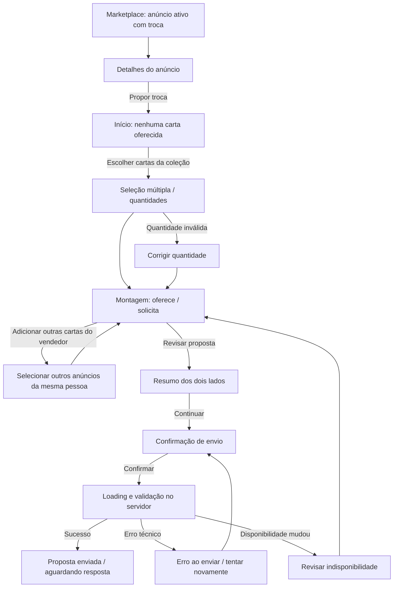

# TCG Market — Handoff de Design | Criação de Proposta de Troca

**Entrega:** Sprint 8 — protótipo de alta fidelidade  
**Data:** 31/10/2026  
**Projeto:** PI3 — TCG Market  
**Referência visual:** `frontend/src/index.css` no repositório `PI3-TCG/TCGMarket`  
**Formato:** 13 telas PNG estáticas, 1600 × 1000 px, acompanhadas deste handoff.

> **Decisões de escopo consolidadas:** sem breadcrumbs no layout; troca exclusivamente de cartas; nenhum pagamento, preço, saldo ou complemento financeiro faz parte da proposta. O texto original da tarefa previa complemento financeiro, mas esse item foi **substituído pela decisão de produto** de não incluir valores.

## 1. Objetivo da experiência

Permitir que uma pessoa autenticada abra um anúncio com troca habilitada e envie uma proposta oferecendo **uma ou mais cartas da própria coleção** em troca de **uma ou mais cartas anunciadas por um único vendedor**. O envio cria uma proposta para análise do vendedor; não confirma nem executa automaticamente a troca.

**Escopo deste protótipo:** iniciar, montar, revisar e enviar a proposta, incluindo seleção, quantidades, validações e feedback. A análise, aceitação, recusa, entrega e encerramento da troca pertencem a outros fluxos.

## 2. Princípios de interação aprovados

1. **Entrada contextual:** a ação `Propor troca` aparece somente em anúncio ativo, com troca habilitada e quantidade disponível.
2. **Anúncio de origem obrigatório:** a carta do anúncio que iniciou o fluxo entra inicialmente na lista `Você solicita` com quantidade 1.
3. **Uma única contraparte:** outras cartas solicitadas devem vir de anúncios de troca **do mesmo vendedor**. Não misturar vendedores numa proposta.
4. **Seleção múltipla dos dois lados:** permitir vários itens distintos e diferentes quantidades para cada item.
5. **Oferta vinculada à coleção:** selecionar apenas `collectionItem` do usuário autenticado, preservando sua condição e idioma.
6. **Restrições de disponibilidade:** cada quantidade é inteira, `>= 1` e `<=` disponível para o item ou anúncio. A mesma origem selecionada duas vezes deve ser agregada ou bloqueada para impedir contagem duplicada.
7. **Sem avaliação financeira:** não existem campos, cálculos, botões ou simulações de pagamento no fluxo.
8. **Confirmação explícita:** a ação final apenas **envia uma proposta**, sem movimentar a coleção.
9. **Recuperabilidade:** erro de rede não deve apagar a seleção; disponibilidade alterada exige ajuste antes do envio.

## 3. Mapa do fluxo



### Pontos de atenção no fluxo

- Na **seleção vazia**, `Revisar proposta` permanece desabilitado. O anúncio solicitado já está identificado, mas falta ao menos uma carta oferecida.
- Se não existirem outros anúncios elegíveis do vendedor, a lista de cartas solicitadas fica com apenas a carta original e o seletor adicional mostra um estado vazio, sem interromper a proposta.
- O usuário pode voltar do resumo para editar a seleção preservando o estado local.
- Fechar o modal inicial retorna ao anúncio. O comportamento após sair da montagem (manter rascunho nesta sessão ou descartar) deve ser explicitado antes da implementação; recomendação: solicitar confirmação caso existam edições não enviadas.

## 4. Inventário de telas e especificação visual

Todas as imagens estão em `png/`.

| Tela | Arquivo | Conteúdo / comportamento principal |
| --- | --- | --- |
| 01 | `01_entrada_anuncio_troca.png` | Detalhes do anúncio; chip azul `Troca` e CTA `Propor troca`. |
| 02 | `02_proposta_selecao_vazia.png` | Modal inicial, anúncio solicitado visível e estado vazio das cartas oferecidas; avançar desabilitado. |
| 03 | `03_selecao_multiplas_cartas_colecao.png` | Busca, filtro por jogo, seleção múltipla e incrementos de exemplares da própria coleção. |
| 04 | `04_montagem_oferta_quantidades.png` | Composição em duas colunas: `Cartas que você oferece` e `Cartas que você solicita`, com ajuste de quantidades. |
| 05 | `05_escolher_cartas_mesmo_vendedor.png` | Seleção de outros anúncios elegíveis do mesmo vendedor; nunca de vendedores diferentes. |
| 06 | `06_proposta_multiplas_cartas_ambos_lados.png` | Duas cartas distintas na oferta e duas na solicitação; cada uma com sua quantidade. |
| 07 | `07_resumo_proposta.png` | Revisão lado a lado, descrições das cartas, totais de exemplares, retorno à edição. |
| 08 | `08_confirmar_envio.png` | Confirmação explícita antes do POST; esclarece que o envio não realiza a troca. |
| 09 | `09_envio_loading.png` | Submissão em processamento; proteção contra cliques repetidos. |
| 10 | `10_proposta_enviada.png` | Sucesso, identificador da proposta ilustrativo, status `Aguardando resposta` e navegação de saída. |
| 11 | `11_carta_indisponivel.png` | Aviso quando uma carta solicitada deixa de ter estoque; revisar ou remover. |
| 12 | `12_quantidade_invalida.png` | Mensagem contextual para quantidade que excede a disponível; não prosseguir sem corrigir. |
| 13 | `13_erro_envio.png` | Erro de envio, seleção preservada e ação de tentar novamente. |

**Nota:** nomes e artes das cartas, vendedor `Lynari` e número `#TRC-0248` são exemplos visuais, não dados reais do catálogo. O frontend deve usar as imagens e metadados da API.

## 5. Design System

Tokens consultados no repositório público em `frontend/src/index.css`; respeitar os componentes e estilos reais existentes ao implementar.

| Finalidade | Token / valor |
| --- | --- |
| Ação principal / títulos de destaque | `primary-900: #660366` |
| Roxo auxiliar | `primary-700: #996699` |
| Roxo claro / seleção | `primary-100: #F0E3F0` |
| Chip `Troca` | `secondary-700: #0969D7`, fundo `secondary-100: #E4F1FF` |
| Chip `Venda` no Marketplace | roxo, conforme padrão existente (fora da negociação de troca) |
| Fundo da página | `neutral-50: #FAFBFE` |
| Cards e modais | `neutral-0: #FFFFFF` |
| Bordas | `neutral-200: #E6E7F0` |
| Texto principal | `neutral-900: #302B40` |
| Texto auxiliar | `neutral-500: #74788A` |
| Feedback de erro | `error-700: #B91C1C` e `error-50: #FDECEC` |
| Sucesso | `success-700: #15803D` e `success-50: #E7F6EC` |
| Alerta | `warning-700: #D97706` e `warning-50: #FFF6E8` |
| Tipografia de títulos / marca | `Cinzel` (`font-display`) |
| Texto e componentes | `Plus Jakarta Sans` (`font-sans`) |
| Raio dos controles | `8px` |
| Raio de superfícies | `12px` |
| Sombras | `shadow-sm`, `shadow-md`, `shadow-lg` conforme tokens existentes |

### Padrão de composição

- Conservar navbar e footer compartilhados já presentes no sistema; não criar variações apenas para a troca.
- **Não inserir breadcrumb/caminho da página.** O título da página e as etapas do fluxo bastam.
- Estruturar a montagem em dois blocos visuais de mesma importância, com chips de tonalidades diferentes para oferta e solicitação.
- Exibir carta, nome, TCG, condição, idioma e quantidade disponível; diferenciá-la por `collectionItemId` quando houver cópias com características diferentes.
- Contadores devem deixar clara a distinção entre **cartas distintas/itens** e **exemplares/quantidades**.
- Modais com título, descrição, botão de fechar, ação primária e secundária; organizar em `md` e `lg` conforme os tamanhos suportados pelo projeto.
- Durante carregamento, manter contexto visual e desabilitar ações que alterem ou reenviem o pedido.
- As artes utilizadas nos PNGs são **ilustrativas**; reutilizar `imageUrl` com fallback do catálogo do projeto.

## 6. Componentização sugerida (React + TypeScript)

```text
MarketplaceAdDetailModal
  └─ ProposeTradeButton (apenas quando elegível)
TradeProposalFlow
  ├─ TradeStepIndicator
  ├─ TradeRequestedItemsPanel
  │    └─ RequestedItemRow
  ├─ TradeOfferedItemsPanel
  │    └─ OfferedCollectionItemRow
  ├─ TradeCollectionPickerModal
  ├─ TradeSellerAdsPickerModal
  ├─ TradeQuantityStepper
  ├─ TradeProposalReview
  ├─ TradeConfirmModal
  ├─ TradeSubmittingState
  ├─ TradeUnavailableItemsModal
  ├─ TradeInvalidQuantityFeedback
  ├─ TradeSubmissionErrorModal
  └─ TradeSubmissionSuccess
```

**Reutilização preferida:** modal acessível e focus trap existentes, componente de carta e fallback de imagem, dados da coleção, estados padrão de erro/loading, layout da navbar/footer, botões e chips. Evitar duplicar lógica da consulta de anúncios e da coleção.

### Estado local sugerido

```ts
type TradeDraft = {
  sourceAdId: string;
  sellerId: string; // obtido do anúncio de origem; não confiar nele como autoridade no backend
  offeredItems: Array<{
    collectionItemId: string;
    quantity: number;
  }>;
  requestedItems: Array<{
    adId: string;
    quantity: number;
  }>;
};

type TradeFlowStatus =
  | 'INITIAL'
  | 'SELECTING'
  | 'REVIEWING'
  | 'CONFIRMING'
  | 'SUBMITTING'
  | 'SUCCESS'
  | 'VALIDATION_ERROR'
  | 'SUBMISSION_ERROR';
```

- A identidade do proponente vem da sessão autenticada, **nunca** do corpo da requisição.
- O `sourceAdId` deve ser um dos itens solicitados durante todo o fluxo; caso o usuário remova a carta original, definir se a proposta muda de origem ou se a remoção é bloqueada. **Recomendação de UX:** bloquear a remoção da carta de origem, mas permitir mudar sua quantidade até o limite disponível. Esse ponto requer acordo de negócio.
- Guardar estado por `collectionItemId`/`adId`, não por nome da carta; nomes não são identificadores únicos.

## 7. Contrato de dados proposto — dependente de implementação

> Os endpoints de proposta abaixo são **sugestões de contrato para a Sprint 8**, não afirmações sobre rotas já existentes no backend. Devem ser refinados com a equipe de backend.

### Dados de entrada

- Anúncio de origem: ID, `sellerId`, `collectionItemId`, `tradeEnabled`, `status`, `remainingQuantity`, carta e metadados.
- Coleção do usuário: reutilizar os recursos já existentes de coleção autenticada (`GET /api/users/me/collection`, com paginação) e respectivas informações de disponibilidade. Não buscar itens de outro usuário para a oferta.
- Outros anúncios solicitados: filtrar por `sellerId` do anúncio original, `tradeEnabled=true`, `status=ACTIVE` e `remainingQuantity>0`. Implementar filtro na API caso não exista.
- Se o volume exigir, oferecer paginação e busca por nome/TCG nos seletores.

### Exemplo de envio (contrato a combinar)

```http
POST /api/trade-proposals
Content-Type: application/json
Authorization: Bearer <token>
```

```json
{
  "sourceAdId": "ad-origem-001",
  "offeredItems": [
    { "collectionItemId": "collection-101", "quantity": 1 },
    { "collectionItemId": "collection-102", "quantity": 2 }
  ],
  "requestedItems": [
    { "adId": "ad-origem-001", "quantity": 1 },
    { "adId": "ad-mesmo-vendedor-002", "quantity": 1 }
  ]
}
```

**Resposta proposta:** `id`, `status` (inicial sugerido `PENDING`), `createdAt`, `sellerId` e os itens normalizados. O backend deve validar o dono dos itens, o dono dos anúncios e as quantidades com os valores atuais no banco. Valores financeiros **não** integram o request nem a resposta desse fluxo.

### Erros e tratamento sugeridos

| Condição | Tratamento de interface |
| --- | --- |
| `401 / 403` | Solicitar autenticação ou informar falta de permissão, preservando contexto se possível. |
| `404` no anúncio inicial | Informar que o anúncio não está mais disponível; retornar ao Marketplace. |
| `409` de alteração de disponibilidade | Mostrar itens afetados, quantidade anterior e atual; impedir envio até revisão. |
| `422` de dados inválidos | Sinalizar item/campo e manter quantidades válidas e seleção do usuário. |
| `429 / 5xx / rede` | Mostrar erro técnico e ação `Tentar novamente`, sem limpar o rascunho. |
| Sucesso (`201` ou contrato equivalente) | Exibir identificador e status `Aguardando resposta`. |

**Idempotência:** prevenir duplo clique no frontend e acordar identificador de requisição no backend se necessário, para não criar propostas duplicadas por retry.

## 8. Validações obrigatórias

| Regra | Frontend | Backend |
| --- | --- | --- |
| Usuário autenticado | Checar sessão antes de entrar | Checar sessão/autorização |
| Anúncio ativo e com troca | Exibir CTA apenas se elegível | Revalidar ao enviar |
| Carta oferecida pertence ao proponente | Picker da coleção autenticada | Conferir proprietário |
| Todos anúncios solicitados pertencem ao mesmo vendedor | Picker restrito e indicação do vendedor | Conferir `sellerId` de cada anúncio |
| Mínimo 1 item oferecido e 1 solicitado | Bloquear avanço | Rejeitar request vazio |
| Quantidades inteiras positivas | Stepper mínimo 1 | Validar `>= 1` |
| Quantidade oferecida não excede disponibilidade | Bloquear e mostrar erro contextual | Revalidar antes de persistir |
| Quantidade solicitada não excede `remainingQuantity` | Bloquear e mostrar erro contextual | Revalidar antes de persistir |
| IDs repetidos não aumentam quantidades indevidamente | Consolidar por ID | Validar somatórios |
| Sem complementar com dinheiro | Não mostrar campos financeiros | Não permitir campos financeiros nesse contrato |
| Enviar não executa troca | Texto de confirmação claro | Persistir proposta, sem transferência automática |

**Concorrência:** o usuário pode perder disponibilidade entre seleção e envio. A conferência final é sempre responsabilidade do backend. A criação da proposta não deve pressupor reservas automáticas sem regra aprovada para isso.

## 9. Estados visuais e mensagens

### Seleção vazia

`Nenhuma carta selecionada. Adicione cartas da sua coleção para montar sua oferta.`  
CTA: `Escolher cartas da minha coleção`. Ação de revisão desabilitada.

### Quantidade inválida

`Você tentou oferecer 5 exemplares, mas possui apenas 4 disponíveis. Use um número entre 1 e 4.`  
Exibir junto ao item e impedir confirmação. Pode-se limitar incremento no controle; ainda assim, validar entradas programáticas e mudanças de estoque.

### Carta indisponível

`A disponibilidade mudou. Revise os itens antes de prosseguir.`  
Mostrar item afetado e permitir remoção/correção. O anúncio original indisponível interrompe o fluxo e solicita retorno ao Marketplace.

### Carregamento

`Enviando sua proposta...`  
Desabilitar ações de enviar e fechar durante o envio crítico; indicar processamento. No carregamento de listas, usar skeletons/placeholder e opção de tentar novamente.

### Confirmação

`Confirmar e enviar proposta`  
Resumo de oferta e solicitação, com aviso de que o envio **não conclui a troca**.

### Enviado

`Proposta enviada com sucesso!`  
Mostrar número/ID, status `Aguardando resposta` e ações `Ver minhas propostas` / `Voltar ao Marketplace`.

### Erro no envio

`Não conseguimos concluir o envio. Seus itens selecionados continuam na proposta para que você tente novamente.`  
Ações: `Voltar à proposta`, `Tentar novamente`.

## 10. Responsividade e acessibilidade

- **Desktop**: dois painéis lado a lado para cartas oferecidas/solicitadas; modal de seleção até tamanho `lg`, respeitando a área visível.
- **Tablet**: reduzir colunas da seleção e permitir scroll dentro do modal; os painéis principais podem se empilhar quando não couberem confortavelmente.
- **Mobile**: uma coluna; botões principais em largura total; cards com textos e stepper legíveis, sem corte lateral.
- Botões com foco visível, rótulos de ícones e `aria-label` nos controles de quantidade/remoção.
- Ao abrir o modal, mover foco para seu título/primeiro controle e aplicar **focus trap**; ao fechar, retornar o foco ao acionador.
- Alertas dinâmicos de erro e sucesso anunciados com `aria-live` apropriado; não depender apenas da cor.
- Evitar modais extensos que cortem a ação primária. Usar scroll **interno** se o viewport for baixo.
- Desabilitar botões com atributo real `disabled`, não só opacidade visual.

## 11. Itens para alinhamento com PO/backend

1. **Solicitações de múltiplas cartas:** proposta usa mais de um anúncio ativo do mesmo vendedor, sempre começando no anúncio de origem. Confirmar se essa será a modelagem definitiva.
2. **Quantidade do anúncio original:** recomendar que seja editável, mas que o item de origem não possa ser removido no rascunho.
3. **Reserva de cartas:** não foi definida na tarefa. Não reservar nem baixar estoque automaticamente ao **enviar** a proposta sem decisão específica.
4. **Status de proposta e tela `Minhas propostas`:** nomes, permissões e rotas finais dependem da modelagem do módulo de trocas.
5. **Disponibilidade efetiva em múltiplas propostas:** decidir se propostas pendentes afetam estoque ou apenas trocas aceitas/concluídas.
6. **Comportamento ao sair do fluxo:** sugerida confirmação de descarte, sem persistência de rascunho nesta primeira versão.

## 12. Critérios de aceite — resultado do protótipo

- [x] Entrada a partir de anúncio com troca habilitada representada.
- [x] Seleção de cartas da coleção representada.
- [x] Oferta com múltiplas cartas e múltiplos exemplares representada.
- [x] Solicitação com múltiplas cartas do mesmo vendedor representada.
- [x] Quantidades definidas e sujeitas a limites.
- [x] Resumo visual e confirmação de envio definidos.
- [x] Estados de seleção vazia, carta indisponível, quantidade inválida, loading, confirmação, sucesso e erro representados.
- [x] Tokens visuais do Design System considerados.
- [x] Navbar/footer preservados visualmente; **sem breadcrumbs**.
- [x] Complemento financeiro retirado conforme decisão explícita; **somente troca de cartas**.
- [x] Especificações de comportamento, componente, validação e contrato sugerido documentadas para a Sprint 8.

**Pronto para repasse ao desenvolvimento, com os pontos de alinhamento acima explicitados.** Este pacote consiste em protótipos **estáticos** e documento de handoff; não contém funcionalidade implementada nem confirmações de endpoints existentes para a negociação.
