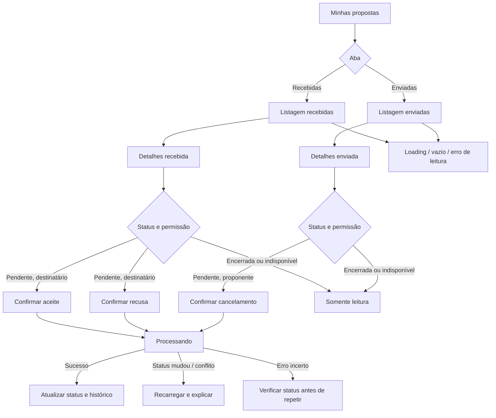

# TCG Market — Handoff de Design | Acompanhamento e Gerenciamento de Propostas de Troca

**Projeto:** PI3 — TCG Market  
**Entrega:** Sprint 8 — protótipos de alta fidelidade  
**Data de referência:** 31/10/2026  
**Formato:** 16 telas PNG estáticas, 1600 × 1000 px, mais visão geral.  
**Base visual:** Design System do frontend em `frontend/src/index.css` do repositório `PI3-TCG/TCGMarket` e os protótipos anteriores de criação de proposta.

> **Decisões de produto mantidas:** (1) nenhuma tela tem breadcrumb; (2) trocas **somente de cartas**, sem dinheiro, valores, complemento financeiro, pagamento ou simulação financeira; (3) a proposta pode conter **múltiplos itens e quantidades dos dois lados**, sempre negociados entre duas pessoas.

## 1. Objetivo e escopo

Permitir que uma pessoa autenticada acompanhe propostas de troca que **recebeu** e que **enviou**, consulte seu conteúdo e pratique apenas as ações autorizadas pelo seu papel e pelo estado da proposta. O módulo apresenta status de negociação e mantém o histórico das propostas encerradas.

A ação de **aceitar** registra uma concordância com a proposta; **não representa transferência instantânea das cartas**. A forma de concluir o intercâmbio físico/digital e a eventual reserva definitiva de exemplares devem ser definidos pelo PO e pelo backend.

Não faz parte desta tarefa: criação/edição de oferta (outro fluxo já prototipado), negociação de dinheiro, pagamento, chat entre participantes, logística ou confirmação de entrega.

## 2. Inventário das 16 telas

Todas as telas estão no diretório `png/`:

| Nº | Nome do arquivo | Estado / função |
|---:|---|---|
| 01 | `01_propostas_recebidas.png` | Aba **Recebidas** com exemplos pendente, aceita e recusada; ações condicionais. |
| 02 | `02_propostas_enviadas.png` | Aba **Enviadas** com exemplos pendente, aceita e cancelada. |
| 03 | `03_detalhes_recebida_pendente.png` | Detalhes de proposta recebida, itens/quantidades, linha do tempo, **Aceitar** e **Recusar**. |
| 04 | `04_detalhes_enviada_pendente.png` | Detalhes de proposta enviada; **Cancelar** enquanto pendente. |
| 05 | `05_confirmar_aceite.png` | Confirmação de aceite com resumo dos dois lados e efeito da ação. |
| 06 | `06_proposta_aceita.png` | Resultado do aceite com selo verde e histórico, sem reexibir ações pendentes. |
| 07 | `07_confirmar_recusa.png` | Confirmação de recusa, com consequência explicada antes da decisão. |
| 08 | `08_proposta_recusada.png` | Resultado recusado, somente visualização. |
| 09 | `09_confirmar_cancelamento.png` | Confirmação de cancelamento pelo **proponente**. |
| 10 | `10_proposta_cancelada.png` | Resultado cancelado, somente visualização. |
| 11 | `11_sem_propostas.png` | Aba vazia com contextualização e orientação para consultar anúncios. |
| 12 | `12_proposta_indisponivel.png` | Bloqueio por indisponibilidade/alteração de quantidades, com aviso claro. |
| 13 | `13_carregando_propostas.png` | Skeleton de carregamento das listagens. |
| 14 | `14_erro_ao_carregar.png` | Erro de leitura da listagem, com **Tentar novamente**. |
| 15 | `15_processando_aceite.png` | Loading de ação, com botões desabilitados para não duplicar o envio. |
| 16 | `16_erro_ao_responder_proposta.png` | Falha/incerteza após ação; recomenda atualização do status antes de repetir. |

**Dados visuais ilustrativos:** nomes `Lynari`, `Caelus`, `Vellian`; códigos `#TRC-...`; nomes e artes das cartas. Não são evidências de dados já implementados na aplicação. Substituir por informações vindas da API e imagem com fallback.

## 3. Mapa de navegação e ações



### Organização visual

- A entrada é pelo item **Minhas propostas** da navegação autenticada; também pode ser vinculada à confirmação de envio da tarefa anterior.
- Duas abas mutuamente exclusivas, **Recebidas** e **Enviadas**, com contadores de propostas conforme API.
- Ambas as abas têm busca por carta, ID ou outra pessoa, filtro de status, ordenação e paginação. A filtragem deve corresponder à aba ativa.
- Os cards de listagem mostram contraparte, horário relativo, selo de status, resumo visual das cartas com contagem de exemplares e ação contextual.
- Os detalhes mostram ID, pessoa contraparte, data de criação, status atual, itens dos dois lados, quantidades e histórico resumido.
- **“Você recebe”** e **“Você entrega”** são sempre nomes relativos ao usuário autenticado, tanto em **Recebidas** quanto em **Enviadas**. Na primeira aba, o usuário recebe o que o proponente ofereceu; na segunda, recebe o que solicitou do destinatário.
- Modais preservam a tela de detalhes ao fundo e exigem confirmação antes de ações que mudam o status.
- **Não usar breadcrumb.** O contexto é fornecido pelo título, pelo código da proposta e pelo retorno à listagem.

## 4. Matriz de permissões e status

| Papel do usuário | Status atual | Ver detalhes | Aceitar | Recusar | Cancelar |
|---|---|:---:|:---:|:---:|:---:|
| Destinatário (recebeu proposta) | `PENDING` | ✅ | ✅* | ✅ | ❌ |
| Proponente (enviou proposta) | `PENDING` | ✅ | ❌ | ❌ | ✅* |
| Qualquer participante | `ACCEPTED` | ✅ | ❌ | ❌ | ❌ |
| Qualquer participante | `DECLINED` | ✅ | ❌ | ❌ | ❌ |
| Qualquer participante | `CANCELLED` | ✅ | ❌ | ❌ | ❌ |
| Qualquer participante | **Indisponível** | ✅ | ❌ | ❌ | ❌ |

`*` **Aceite** requer revalidação no servidor da elegibilidade e disponibilidade dos exemplares dos **dois participantes**; **cancelamento** só pode ocorrer antes da resposta. O frontend apenas orienta — a decisão autorizativa é do backend.

### Transições recomendadas

| Origem | Ação | Ator | Destino sugerido |
|---|---|---|---|
| `PENDING` | Aceitar | Destinatário | `ACCEPTED` |
| `PENDING` | Recusar | Destinatário | `DECLINED` |
| `PENDING` | Cancelar | Proponente | `CANCELLED` |
| Qualquer estado fechado | Aceitar, recusar, cancelar | Qualquer | Rejeitar; estado permanece |
| `PENDING` | Disponibilidade alterada | Sistema | **Bloqueio de ação**; tratamento a definir |

**Decisão pendente para o PO/backend:** `UNAVAILABLE` pode ser um status persistido ou apenas um estado calculado de impedimento à ação quando itens não estão disponíveis. O protótipo usa **Indisponível como status visual**, sem presumir que uma enumeração `UNAVAILABLE` já exista. A implementação precisa especificar se o sistema encerra a proposta automaticamente, permite corrigir quantidades, ou exige criar outra proposta. Não permitir aceite de proposta inválida.

**Importante:** quando a proposta é aceita, nenhuma carta deve ser transferida automaticamente **sem regra de conclusão implementada**. A eventual reserva de exemplares, bloqueio contra negociações simultâneas e fluxo de conclusão são decisões que precisam de alinhamento.

## 5. Design System e componentes

Tokens revisados no `frontend/src/index.css`:

| Elemento | Token / valor |
|---|---|
| Roxo principal e CTAs | `primary-900: #660366` |
| Roxo secundário | `primary-700: #996699` |
| Superfície suave roxa | `primary-100: #F0E3F0` |
| Azul / identificação contextual | `secondary-700: #0969D7`, `secondary-100: #E4F1FF` |
| Fundo / cards | `neutral-50: #FAFBFE`, `neutral-0: #FFFFFF` |
| Bordas / texto | `neutral-200: #E6E7F0`, `neutral-900: #302B40` |
| Sucesso / aceite | `success-700: #15803D`, `success-50: #E7F6EC` |
| Atenção / pendência | `warning-700: #D97706`, `warning-50: #FFF6E8` |
| Recusa / erro | `error-700: #B91C1C`, `error-50: #FDECEC` |
| Fonte dos títulos | `font-display: Cinzel` |
| Fonte do corpo | `font-sans: Plus Jakarta Sans` |
| Raio de botões/cards | `radius-control: 8px`, `radius-surface: 12px` |

**Identificação visual:** Pendente em amarelo, Aceita em verde, Recusada em vermelho, Cancelada em cinza, Indisponível em laranja. Sempre associar **texto + cor**, nunca cor isoladamente.

Os PNGs são modelos estáticos. Reutilizar no código o `Header`, `Footer`, botões, chips, modal acessível, estados de loading e erros e componentes de carta já disponíveis no projeto; não tentar reproduzir pixel por pixel com estilos duplicados.

## 6. Dados a apresentar

Cada resumo precisa fornecer pelo menos:

- `id`, `status`, `createdAt`, `updatedAt` (e, se houver, `respondedAt`, `cancelledAt`);
- referência a `proposerId`, `recipientId` e dados públicos mínimos da contraparte;
- itens `offeredItems[]` e `requestedItems[]` com **referência estável à origem**, título, TCG, imagem, condição, idioma e quantidade;
- avaliação de disponibilidade atual (separada do snapshot histórico) para suportar validação de aceite;
- permissões derivadas de identidade e status, preferencialmente via `allowedActions` calculado no backend.

É fundamental **não** reavaliar o conteúdo histórico de uma proposta com base apenas em dados mutáveis do catálogo. Guardar o necessário para apresentar o que realmente foi proposto mesmo quando anúncios e coleções forem alterados.

### Interfaces TypeScript sugeridas

```ts
type TradeProposalStatus = 'PENDING' | 'ACCEPTED' | 'DECLINED' | 'CANCELLED';

type ProposalDirection = 'received' | 'sent';

type ProposalItemSnapshot = {
  cardId: string;
  collectionItemId?: string;
  adId?: string;
  cardName: string;
  game: string;
  imageUrl: string | null;
  condition: string;
  language: string;
  quantity: number;
};

type ProposalActions = {
  canAccept: boolean;
  canDecline: boolean;
  canCancel: boolean;
};

type TradeProposalView = {
  id: string;
  proposerId: string;
  recipientId: string;
  counterpartyDisplayName: string;
  status: TradeProposalStatus;
  availability: 'AVAILABLE' | 'UNAVAILABLE' | 'UNKNOWN';
  createdAt: string;
  updatedAt: string;
  offeredItems: ProposalItemSnapshot[]; // Ofertas feitas pelo proponente
  requestedItems: ProposalItemSnapshot[]; // Itens pedidos ao destinatário
  allowedActions: ProposalActions;
};
```

**Direção derivada:** `received` se `recipientId === authUserId`; `sent` se `proposerId === authUserId`.

**Rótulos relativos ao usuário:**

```ts
const youReceive = direction === 'received'
  ? proposal.offeredItems
  : proposal.requestedItems;
const youDeliver = direction === 'received'
  ? proposal.requestedItems
  : proposal.offeredItems;
```

### Rotas/endpoints — propostas de contrato, **não confirmados no repositório**

| Necessidade | Exemplo de contrato |
|---|---|
| Listar recebidas | `GET /api/users/me/trade-proposals?direction=received&page=1&size=20&status=...` |
| Listar enviadas | `GET /api/users/me/trade-proposals?direction=sent&page=1&size=20&status=...` |
| Buscar detalhes | `GET /api/trade-proposals/{id}` |
| Aceitar | `POST /api/trade-proposals/{id}/accept` |
| Recusar | `POST /api/trade-proposals/{id}/decline` |
| Cancelar | `POST /api/trade-proposals/{id}/cancel` |

Esses caminhos são **sugestões para negociação com o backend**, não rotas afirmadas como já implementadas. Respostas devem retornar o status persistido e, idealmente, a versão atual da proposta para lidar com concorrência.

## 7. Concorrência, segurança e integridade

1. Todas as rotas devem exigir autenticação. O backend decide se o ator é destinatário ou proponente com base na sessão/token, nunca em campos `userId` enviados pelo cliente.
2. Cada ação é permitida **somente** enquanto `PENDING`; usar transição atômica/controle de versão para impedir aceitar e cancelar ao mesmo tempo.
3. Na aceitação, validar que a proposta ainda está pendente, que os anúncios de referência seguem elegíveis e que cada lado tem a quantidade requerida disponível. Validar também itens duplicados e operações simultâneas.
4. Caso o servidor responda **409 Conflict**, recarregar detalhes e explicar que a proposta já foi respondida ou que a disponibilidade mudou.
5. Após timeout de uma ação, **não assumir falha**, pois a mudança pode ter sido processada: primeiro consultar o status atualizado; não repetir POST indefinidamente.
6. Manter histórico de propostas recusadas e canceladas sem apagar documentos e sem permitir ações que só existem no status pendente.
7. Contagens de cards devem separar **tipos distintos de carta** de **exemplares**. Ex.: dois tipos, três exemplares.
8. Não mostrar preço, carteira, saldo, frete, campo financeiro, pagamento ou complemento de valor.
9. Operações de aceite/recusa/cancelamento devem ter logs de auditoria úteis para rastrear quem respondeu e quando.

## 8. Estados e feedback de interface

- **Sem propostas:** mensagem específica para aba Recebidas e outra para Enviadas; CTA contextual e nenhuma tabela vazia sem orientação.
- **Pendente:** destaque amarelo; ações apenas conforme papel.
- **Aceita:** destaque verde; histórico disponível; sem ações de decisão repetidas.
- **Recusada:** destaque vermelho; sem reabrir a mesma proposta.
- **Cancelada:** destaque cinza; não pode voltar a pendente na mesma proposta.
- **Indisponível:** aviso com motivo e impossibilidade de aceite; comportamento de correção/encerramento depende da decisão de negócio.
- **Loading de listagem:** skeletons nas áreas de cards, mantendo estrutura da página.
- **Erro de listagem:** painel amigável com tentar novamente e preservação de filtros quando possível.
- **Loading de ação:** spinner/modal sem ações ativas e sem cliques duplicados.
- **Erro de ação:** indicar quando a resposta do servidor é inconclusiva; atualizar status antes de oferecer nova tentativa.

## 9. Componentização sugerida

```text
MyTradeProposalsPage
  ├─ SharedHeader / SharedFooter
  ├─ TradeProposalsHero
  ├─ ProposalDirectionTabs (received | sent)
  ├─ ProposalSearchAndFilters
  ├─ ProposalList
  │    ├─ TradeProposalCard
  │    │    ├─ TradeStatusChip
  │    │    └─ TradeCardMiniPreview
  │    ├─ ProposalListSkeleton
  │    ├─ ProposalListEmptyState
  │    └─ ProposalListErrorState
  └─ TradeProposalDetailsPage
       ├─ ProposalMetadata
       ├─ YouReceivePanel
       ├─ YouDeliverPanel
       ├─ ProposalTimeline
       ├─ ProposalActionBar
       ├─ AcceptTradeConfirmationModal
       ├─ DeclineTradeConfirmationModal
       ├─ CancelTradeConfirmationModal
       └─ ProposalActionFeedback
```

**Reutilização:** `Modal`/focus trap, botões, chips, coleções/anúncios, `Card`/fallback de arte, `useRemoteData` (ou padrão vigente), paginação e componentes compartilhados. Recomenda-se centralizar a conversão `received/sent` → `youReceive/youDeliver` em um helper testável.

## 10. Responsividade e acessibilidade

- Desktop: duas colunas nos detalhes; celular: uma coluna vertical com os blocos completos e ações em largura total.
- Não depender de hover para identificar ações ou estados.
- Status sempre com texto e cor; foco visível nos botões e abas; controles reais em HTML semântico.
- A navegação por teclado deve alcançar abas, busca, filtros, ações e fechamento dos modais; manter focus trap durante o modal, `Escape` conforme política adotada e devolver foco ao acionador.
- Alertas de status devem ser anunciáveis (`role=status`, `aria-live=polite`) e mensagens de erro específicas (`role=alert` quando cabível).
- Garantir contraste de texto/ícones; quantidades numéricas acessíveis por texto e não apenas pelas miniaturas.
- Feedback de ação demorada não deve depender exclusivamente da animação do spinner.

## 11. Critérios de aceite de design / checklist de desenvolvimento

- [x] Tela de propostas recebidas.
- [x] Tela de propostas enviadas.
- [x] Detalhes completos dos dois lados da troca.
- [x] Cartas e quantidades individualizadas.
- [x] Confirmação de aceite.
- [x] Confirmação de recusa.
- [x] Confirmação de cancelamento pelo proponente.
- [x] Status visualmente distintos.
- [x] Vazio, indisponibilidade, loading e erro.
- [x] Componentes e tokens de Design System indicados.
- [x] Handoff e sugestões técnicas para Sprint 8.
- [x] Sem breadcrumb e sem elemento financeiro.
- [ ] Backend deve confirmar contratos, status persistidos, regras de aceite/entrega e estratégia de disponibilidade.
- [ ] Implementação e testes de regressão ainda devem ser realizados na Sprint 8.

## 12. Pendências para alinhamento com PO

1. **Aceite e reserva:** aceitar a proposta bloqueia imediatamente os exemplares? A troca passa a que status operacional depois de `ACCEPTED`? Quais são as regras de confirmação da entrega?
2. **Indisponibilidade:** exibir bloqueio transitório, cancelar automaticamente ou permitir que o proponente envie uma nova proposta ajustada?
3. **Cancelamento:** restringir a `PENDING` (recomendado) ou permitir outro prazo?
4. **Sinalização:** haverá notificações na navbar e e-mail em caso de nova proposta ou resposta? Definir separadamente.
5. **Busca e contadores:** escopo exato da busca, filtros disponíveis e regra de contagem nos badges das abas.

---

**Resumo:** este handoff conclui o **design e a especificação de interação** do módulo de acompanhamento e gerenciamento. Os screenshots são protótipos estáticos; não representam funcionalidades já implementadas ou endpoints confirmados.
