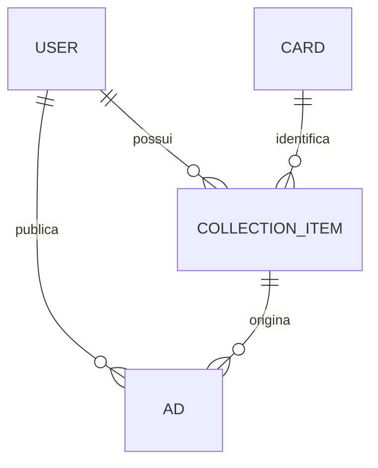

# Modelagem da Classe `Ad` (Anúncio)

> **Projeto:** TCG Market — Marketplace de cartas colecionáveis  
> **Escopo:** Modelagem de anúncios, vínculo com coleção e validação da disponibilidade.  
> **Situação:** Proposta de modelagem para implementação em Java, Spring Boot e MongoDB.

## Classe `Ad`

### Descrição

A classe `Ad` representa uma oferta publicada por um usuário para disponibilizar uma carta no marketplace, por **venda**, **troca** ou **ambas** as modalidades.

Cada anúncio pertence a um usuário (`sellerId`) e está vinculado a um item de sua coleção (`collectionItemId`). As informações globais da carta — como nome, jogo, edição e imagem — são obtidas indiretamente a partir do catálogo (`Card`), evitando duplicação de dados. Condição e idioma pertencem ao item da coleção (`CollectionItem`).

O anúncio controla a quantidade anunciada, a quantidade ainda disponível para negociação, as modalidades aceitas, o preço quando houver venda, o status e as datas relevantes para seu histórico.

### Atributos

| Atributo | Tipo | Descrição |
| --- | --- | --- |
| `id` | ObjectId | Identificador único do anúncio. |
| `sellerId` | ObjectId | Referência ao usuário proprietário do anúncio; deve coincidir com `CollectionItem.userId`. |
| `collectionItemId` | ObjectId | Referência ao item da coleção do usuário que contém a carta anunciada. |
| `unitPrice` | BigDecimal | Preço unitário da carta; obrigatório e maior que zero quando `saleEnabled = true`, senão `null`. |
| `quantity` | Integer | Quantidade originalmente anunciada; deve ser maior que zero. |
| `remainingQuantity` | Integer | Unidades do anúncio que ainda não foram negociadas; inicialmente igual a `quantity`. |
| `description` | String | Informações adicionais fornecidas pelo vendedor sobre o anúncio. |
| `status` | `AdStatus` (Enum) | Situação atual: `ACTIVE`, `CANCELLED` ou `SOLD_OUT`. |
| `saleEnabled` | Boolean | Indica se o anúncio aceita venda. |
| `tradeEnabled` | Boolean | Indica se o anúncio aceita troca. |
| `createdAt` | LocalDateTime | Data e horário de criação do anúncio. |
| `updatedAt` | LocalDateTime | Data e horário da última alteração. |
| `cancelledAt` | LocalDateTime | Data e horário do cancelamento, quando aplicável; caso contrário, `null`. |
| `soldOutAt` | LocalDateTime | Data e horário do esgotamento, quando aplicável; caso contrário, `null`. |

> **Observação técnica:** os tipos acima seguem a modelagem conceitual original. Na implementação Java, os identificadores devem ser compatibilizados com os tipos efetivamente utilizados nas entidades e repositórios existentes. Recomenda-se `BigDecimal` em Java e representação decimal exata (como `Decimal128`) no MongoDB para valores monetários. As datas podem ser serializadas como instantes UTC na persistência.

### Enum `AdStatus`

| Valor | Descrição |
| --- | --- |
| `ACTIVE` | Anúncio publicado e disponível para negociação, com `remainingQuantity > 0`. |
| `CANCELLED` | Anúncio cancelado, mantido no banco para preservar histórico; não compromete mais unidades. |
| `SOLD_OUT` | Anúncio cuja quantidade restante chegou a zero após conclusão de vendas e/ou trocas. |

Os três valores atendem ao escopo inicial. Estados como `RESERVED` poderão ser avaliados na modelagem futura de pedidos e negociações, sem serem exigidos nesta etapa.

---

## Classes Referenciadas

### Classe `CollectionItem`

#### Descrição

A classe `CollectionItem` representa uma carta que faz parte da coleção pessoal de um usuário.

Ela permite registrar quais cartas pertencem à coleção do usuário e a quantidade de unidades que ele possui.

#### Atributos

| Atributo       | Tipo          | Descrição                                               |
| -------------- | ------------- | ------------------------------------------------------- |
| `id`           | ObjectId      | Identificador único do item da coleção.                 |
| `userId`       | ObjectId      | Referência ao usuário proprietário da carta.            |
| `cardId`       | ObjectId      | Referência à carta pertencente à coleção.               |
| `quantity`     | Integer       | Quantidade de unidades da carta que o usuário possui.   |
| `condition`    | Enum          | Estado em que se encontra a carta.                      |
| `language`     | Enum          | Idioma da carta.                                        |
| `additionDate` | LocalDateTime | Data e horário em que a carta foi adicionada à coleção. |

---

### Classe `User`

#### Descrição

A classe `User` representa uma pessoa cadastrada na plataforma.

O usuário pode utilizar as funcionalidades do marketplace, como gerenciar seu perfil, anunciar cartas, realizar compras e trocas, administrar sua coleção e lista de desejos e avaliar outros usuários.

#### Atributos

| Atributo            | Tipo                | Descrição                                              |
| ------------------- | ------------------- | ------------------------------------------------------ |
| `id`                | ObjectId            | Identificador único do usuário.                        |
| `name`              | String              | Nome do usuário.                                       |
| `role`              | Enum                | Papel do usuário (Admin ou não).                       |
| `email`             | String              | E-mail utilizado pelo usuário.                         |
| `passwordHash`      | String              | Senha armazenada em formato de hash.                   |
| `phoneNumber`       | String              | Telefone do usuário.                                   |
| `address`           | Objeto/Subdocumento | Endereço associado ao usuário.                         |
| `profilePhoto`      | String              | URL da foto de perfil.                                 |
| `reputation`        | Double              | Reputação calculada a partir das avaliações recebidas. |
| `totalReview`       | Integer             | Quantidade total de avaliações recebidas pelo usuário. |
| `registrationDate`  | LocalDateTime       | Data e horário de cadastro do usuário.                 |

---

### Classe `Card`

#### Tipo

**Classe abstrata**

#### Descrição

A classe `Card` representa uma carta de TCG de forma genérica.

Ela contém as informações que são comuns a todas as cartas, independentemente do jogo ao qual pertencem.

Por ser uma classe abstrata, seu objetivo principal é servir como base para as classes específicas de cada jogo:

* `PokemonCard`
* `YugiohCard`
* `MagicCard`
* `DigimonCard`
* `OnePieceCard`

Dessa forma, informações comuns, como nome, edição e número da coleção, não precisam ser repetidas em cada uma das subclasses.

#### Atributos

| Atributo          | Tipo        | Descrição                                                                                 |
| ----------------- | ----------- | ----------------------------------------------------------------------------------------- |
| `id`              | ObjectId    | Identificador único da carta.                                                             |
| `name`            | String      | Nome da carta.                                                                            |
| `game`            | Enum        | Identifica a qual jogo a carta pertence: Pokémon, Yu-Gi-Oh!, Magic, Digimon ou One Piece. |
| `edition`         | String      | Coleção ou conjunto no qual a carta foi lançada.                                          |
| `codeCollection`  | String      | Código/número impresso na carta dentro da coleção.                                        |
| `cardNumber`      | String      | Código da carta dentro da sua coleção/set.                                                |
| `officialrarity`  | String/Enum | Raridade oficial da carta, como comum, incomum, rara, ultra rara ou secreta.              |
| `imageUrl`        | String      | URL da imagem cadastrada para representar a carta.                                        |
| `externalId`      | String      | ID externo da API utilizada para a captura de dados.                                      |
| `conceptualId`    | String      | Identificador conceitual da carta.                                                        |
| `source`          | Enum        | Fonte da captura dos dados.                                                               |


---

### Classe `PokemonCard`

#### Tipo

**Subclasse de `Card`**

#### Descrição

Representa uma carta pertencente ao jogo Pokémon.

Além das informações herdadas de `Card`, essa classe possui características específicas das cartas Pokémon, como pontos de vida, tipo de energia, estágio de evolução e ataques.

#### Atributos

| Atributo           | Tipo             | Descrição                                                                                                                        |
| ------------------ | ---------------- | -------------------------------------------------------------------------------------------------------------------------------- |
| `hp`               | Integer          | Pontos de vida da carta Pokémon.                                                                                                 |
| `energyType`       | Lista de Enum    | Tipo de energia associado à carta, como Fogo, Água, Grama, Elétrico, Psíquico, Lutador, Sombrio, Metal, Fada, Incolor ou Dragão. |
| `evolutionStage`   | Enum             | Indica o estágio evolutivo: Básico, Estágio 1 ou Estágio 2.                                                                      |
| `pokemonCardType`  | Enum             | Indica se a carta é Pokémon, Treinador ou Energia.                                                                               |
| `recoilCost`       | Integer          | Quantidade de energia necessária para realizar o recuo do Pokémon.                                                               |
| `attack`           | Lista de objetos | Lista contendo os ataques da carta, incluindo informações como nome, custo e dano.                                               |


---

### Classe `YugiohCard`

#### Tipo

**Subclasse de `Card`**

#### Descrição

Representa uma carta pertencente ao jogo Yu-Gi-Oh!.

A classe possui atributos específicos para representar monstros, cartas de Magia e cartas de Armadilha.

#### Atributos

| Atributo          | Tipo          | Descrição                                                                               |
| ----------------- | ------------- | --------------------------------------------------------------------------------------- |
| `atk`             | Integer       | Pontos de ataque da carta.                                                              |
| `def`             | Integer       | Pontos de defesa. Pode ser nulo para cartas de Magia e Armadilha.                       |
| `level`           | Integer       | Nível da carta.                                                                         |
| `rank`            | Integer       | Rank da carta.                                                                          |
| `linkRating`      | Integer       | Valor de Link da carta.                                                                 |
| `attribute`       | Enum          | Atributo do monstro, como Trevas, Luz, Terra, Água, Fogo, Vento ou Divino.              |
| `monsterType`     | String        | Tipo do monstro, como Guerreiro, Dragão, Mago etc.                                      |
| `yugiohCardType`  | Enum          | Indica se a carta é Monstro, Magia ou Armadilha.                                        |
| `invocationForm`  | Lista de Enum | Forma de invocação do monstro, como Normal, Efeito, Fusão, Sincro, Xyz, Link ou Ritual. |


---

### Classe `MagicCard`

#### Tipo

**Subclasse de `Card`**

#### Descrição

Representa uma carta pertencente ao jogo Magic: The Gathering.

A classe armazena informações específicas utilizadas para caracterizar as cartas de Magic, incluindo custo de mana, cor, tipo de carta e atributos de criaturas.

#### Atributos

| Atributo      | Tipo            | Descrição                                                                                                   |
| ------------- | --------------- | ----------------------------------------------------------------------------------------------------------- |
| `manaCost`    | String          | Custo de mana necessário para utilizar a carta, por exemplo `2RR`.                                          |
| `cmc`         | Double          | Custo total convertido da carta.                                                                            |
| `color`       | Lista de Enum   | Cor ou conjunto de cores da carta: Branco, Azul, Preto, Vermelho, Verde, Incolor ou Multicolor.             |
| `cardType`    | Lista de Enum   | Tipo da carta, como Criatura, Feitiço, Mágica Instantânea, Artefato, Encantamento, Planeswalker ou Terreno. |
| `strength`    | String          | Poder da criatura. Utilizado apenas quando a carta representa uma criatura.                                 |
| `resistance`  | String          | Resistência da criatura. Utilizado apenas quando a carta representa uma criatura.                           |
| `superTypes`  | Lista de String | Supertipo da carta, como "Lendária".                                                                        |
| `subTypes`    | Lista de String | Subtipo da carta.                                                                                          |
| `rulesText`   | String          | Texto que descreve as regras e efeitos da carta.                                                            |

---

## Relacionamento entre anúncios, coleção, usuário e catálogo

### Referências e cardinalidades

| Relação | Cardinalidade | Descrição |
| --- | --- | --- |
| `User` → `CollectionItem` | 1:N | Um usuário possui vários itens em sua coleção. |
| `Card` → `CollectionItem` | 1:N | Uma carta do catálogo pode constar nas coleções de vários usuários, com idioma, condição e quantidades próprios. |
| `User` → `Ad` | 1:N | Um usuário pode publicar vários anúncios. |
| `CollectionItem` → `Ad` | 1:N | Um item da coleção pode originar vários anúncios, desde que não ultrapassem sua disponibilidade. |



### Resolução dos dados de um anúncio

1. O anúncio identifica seu proprietário por `sellerId`.
2. O anúncio identifica a posse específica por `collectionItemId`.
3. O `CollectionItem` contém `userId`, `cardId`, `quantity`, `condition` e `language`.
4. O `Card`, identificado por `cardId`, fornece dados globais do catálogo, como nome, jogo, edição e imagem.
5. Antes de criar o anúncio, o backend verifica que `Ad.sellerId == CollectionItem.userId`.

Não é necessário copiar os atributos globais de `Card`, nem os atributos de condição e idioma de `CollectionItem`, para cada novo `Ad`. O campo `sellerId` é uma referência redundante **intencional**, útil para consultas por vendedor, e sua coerência com o proprietário da coleção deve ser validada.

---

## Regras de negócio e validações

### 1. Propriedade e existência

- Todo anúncio deve referenciar um `User` existente e um `CollectionItem` existente.
- O item anunciado deve pertencer ao vendedor: `Ad.sellerId == CollectionItem.userId`.
- O usuário autenticado deve estar autorizado a criar, alterar ou cancelar os anúncios associados à sua conta.
- Um anúncio referencia uma **posse específica** (uma combinação de carta, condição e idioma já registrada na coleção), não apenas uma carta genérica do catálogo.

### 2. Quantidades

- `quantity > 0` na criação do anúncio.
- Na criação: `remainingQuantity = quantity`.
- Sempre: `0 <= remainingQuantity <= quantity`.
- Quando todas as unidades forem efetivamente negociadas, `remainingQuantity = 0` e `status = SOLD_OUT`.
- A cada venda ou troca **concluída**, a quantidade restante do anúncio é reduzida pelo número de unidades negociadas. A quantidade possuída em `CollectionItem` também deve ser atualizada de forma consistente para não contabilizar unidades que já deixaram a coleção.
- O valor inicial de `quantity` fica registrado como referência histórica. Eventuais regras futuras para ampliar ou reduzir anúncios precisarão preservar essas invariantes.

### 3. Cálculo da disponibilidade

Para um determinado `CollectionItem`, considerar a soma das quantidades restantes de **todos os seus anúncios com status `ACTIVE`**:

```text
quantidadeComprometida = SOMA(ad.remainingQuantity)
                         para ad.collectionItemId = collectionItem.id
                         e ad.status = ACTIVE

quantidadeDisponivelParaNovoAnuncio = collectionItem.quantity
                                     - quantidadeComprometida
```

Um novo anúncio só pode ser criado se sua quantidade solicitada for menor ou igual à `quantidadeDisponivelParaNovoAnuncio`.

**Exemplo:** um usuário possui 5 unidades de uma carta em seu `CollectionItem`. Já existem dois anúncios ativos com `remainingQuantity` de 2 e 1. Portanto:

```text
Quantidade na coleção:       5
Comprometida em anúncios:    2 + 1 = 3
Disponível para novo anúncio: 5 - 3 = 2
```

Um terceiro anúncio pode disponibilizar, no máximo, **2 unidades**.

**Atenção à consistência:** a validação não pode depender apenas de uma consulta seguida de uma gravação sem proteção. Se duas solicitações forem feitas simultaneamente, ambas poderiam tentar anunciar as mesmas unidades. A implementação deverá usar uma estratégia de concorrência adequada (por exemplo, controle de versão e atualização condicional ou transação) para garantir o limite. Também deverá impedir a redução da quantidade da coleção abaixo do total já comprometido.

### 4. Modalidades de negociação e preço

Pelo menos uma modalidade deve ser habilitada.

| `saleEnabled` | `tradeEnabled` | Regra para `unitPrice` | Situação |
| --- | --- | --- | --- |
| `true` | `false` | Obrigatório, `> 0` | Válida — somente venda |
| `false` | `true` | Deve ser `null` | Válida — somente troca |
| `true` | `true` | Obrigatório, `> 0` | Válida — venda e troca |
| `false` | `false` | Não aplicável | **Inválida** |

O preço é unitário, não o valor total das unidades. Alterações posteriores nas modalidades e no preço deverão passar novamente pelas mesmas validações.

### 5. Status e histórico

- **Criação:** o anúncio inicia com `status = ACTIVE`, `remainingQuantity = quantity` e `createdAt`/`updatedAt` preenchidos.
- **Esgotamento:** quando `remainingQuantity` chega a zero por negociação concluída, o status passa para `SOLD_OUT` e `soldOutAt` é preenchido.
- **Cancelamento:** o anúncio passa para `CANCELLED`, `cancelledAt` é preenchido e suas unidades remanescentes deixam de compor o cálculo de comprometimento. `remainingQuantity` pode permanecer maior que zero para registrar o que não foi negociado.
- **Histórico:** o cancelamento não exclui o documento, preservando os atributos e o histórico básico do anúncio.
- **Atualização:** `updatedAt` registra as alterações relevantes, incluindo encerramento. Anúncios `CANCELLED` e `SOLD_OUT` não são tratados como ativos.

> Essas datas preservam o estado final e marcos importantes. Um histórico detalhado de cada negociação, reserva ou alteração exigirá entidades ou eventos próprios em uma etapa futura.

### 6. Responsabilidade pela validação

- **Modelo `Ad`:** representa os dados e pode conter invariantes simples, como quantidade não negativa e consistência das modalidades.
- **Serviço de anúncios (`AdService`, nomenclatura sugerida):** valida propriedade da coleção, disponibilidade agregada, transições de estado e regras de negócio que dependem de outras coleções.
- **Repositórios/MongoDB:** realizam consultas e persistência. As operações que alteram quantidade comprometida devem possuir proteção contra concorrência.

---

## Exemplo de documento `Ad` no MongoDB

O exemplo abaixo usa **Extended JSON** para ilustrar como identificadores, valor decimal e datas podem ser armazenados no MongoDB:

```json
{
  "_id": { "$oid": "671000000000000000000001" },
  "sellerId": { "$oid": "671000000000000000000002" },
  "collectionItemId": { "$oid": "671000000000000000000003" },
  "unitPrice": { "$numberDecimal": "24.90" },
  "quantity": 3,
  "remainingQuantity": 2,
  "description": "Carta conservada e protegida em sleeve.",
  "status": "ACTIVE",
  "saleEnabled": true,
  "tradeEnabled": true,
  "createdAt": { "$date": "2026-10-19T18:00:00Z" },
  "updatedAt": { "$date": "2026-10-19T18:30:00Z" },
  "cancelledAt": null,
  "soldOutAt": null
}
```

Os identificadores e datas são ilustrativos. Os tipos BSON efetivamente persistidos dependem dos mapeamentos configurados na aplicação.

---

## Considerações de implementação e extensibilidade

- **Índices sugeridos:** `sellerId + status` para consultar anúncios de um vendedor e `collectionItemId + status` para calcular a quantidade comprometida de um item.
- **Consulta de catálogo:** para exibir nome, imagem, jogo, condição e idioma, recuperar as referências relacionadas em `CollectionItem` e `Card`, em vez de criar campos duplicados em todos os anúncios.
- **Compras e trocas futuras:** pedidos/negociações poderão referenciar `adId`, usuário comprador/interessado, modalidade, quantidade e estado da operação.
- **Reservas futuras:** antes da implementação de checkout ou negociações pendentes, deverá ser definida a distinção entre unidades *disponíveis*, *reservadas* e *efetivamente negociadas*, evitando vendas ou trocas duplicadas. Essa etapa não faz parte do escopo inicial.
- **Cancelamento:** preservar o anúncio para auditoria e histórico; não realizar exclusão física em uma operação normal de cancelamento.

