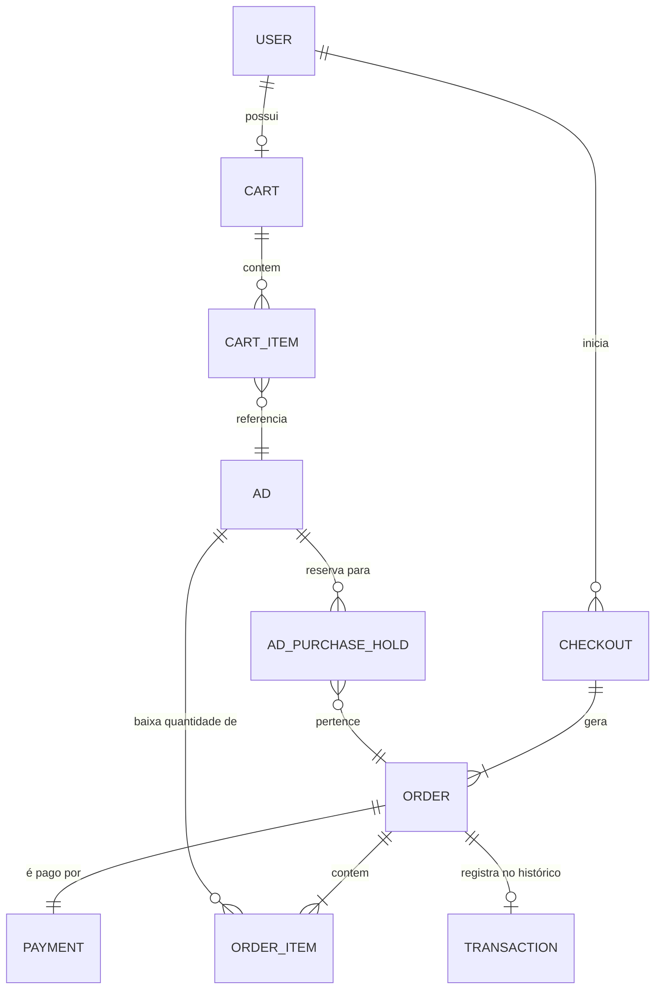
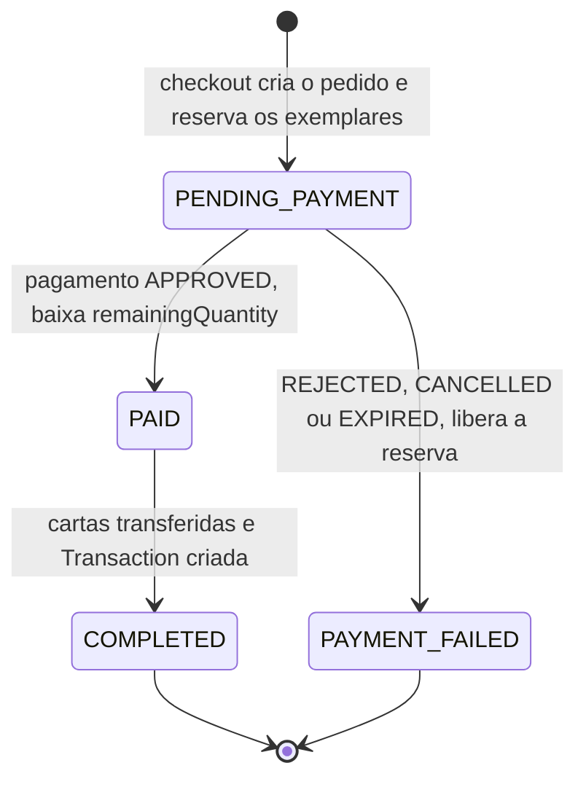

# Modelagem de carrinho, pedido, pagamento e transação

> **Projeto:** TCG Market — Marketplace de cartas colecionáveis  
> **Issue:** #71  
> **Escopo:** domínio do fluxo de compra, do carrinho ao registro final da transação.  
> **Base:** [handoff do carrinho (#59)](../design-system/prototyping/prototype-shoppingCart/Handoff-shoppingCart-V1.md), [spike de pagamento sandbox (#67)](../spikes/TCG-67%20Integra%C3%A7%C3%A3o%20de%20pagamento%20sandbox.md) e [modelagem do anúncio (#60)](./Modelagem%20da%20Classe%20Ad.md).

As classes descritas aqui já existem em `backend/src/main/java/com/pitcc/model`, com repositórios e testes das invariantes. Endpoints, serviços e telas ficam para as issues de implementação (seção 9).

## 1. Visão geral

| Conceito | Classe | Coleção | Papel |
| --- | --- | --- | --- |
| Carrinho | `Cart` | `carts` | Lista de anúncios que o comprador pretende comprar. Um por usuário. Não reserva exemplares. |
| Item do carrinho | `CartItem` | dentro de `carts` | Um anúncio, a quantidade, o preço aceito e se está selecionado. |
| Checkout | `Checkout` | `checkouts` | Uma ação "Simular pagamento". Agrupa os pedidos gerados e garante idempotência. |
| Pedido | `Order` | `orders` | Compra de um comprador a **um** vendedor, com itens, endereço e valores copiados. |
| Item do pedido | `OrderItem` | dentro de `orders` | Anúncio, carta, quantidade e preço no momento da compra. |
| Pagamento | `Payment` | `payments` | Tentativa de pagamento de um pedido no gateway (simulador ou Mercado Pago sandbox). |
| Transação | `Transaction` | `transactions` | Registro imutável da negociação concluída, usado no histórico. |
| Reserva de compra | `AdPurchaseHold` | dentro de `ads` | Exemplares do anúncio separados para um pedido enquanto o pagamento está pendente. |
| Cópias históricas | `CardSnapshot`, `DeliveryAddress` | dentro de `orders` e `transactions` | Dados da carta e do endereço congelados na compra. |



### Por que `Order` e `Transaction` são separados

O diagrama de classes original tinha `Transaction` abstrata com `Sale` e `Exchange`, cada uma com um único anúncio. Isso não comporta um carrinho com vários anúncios e vendedores. Nesta modelagem:

- **`Order` é a compra.** Tem ciclo de vida (pagamento pendente, pago, concluído, falhou) e é o que o comprador acompanha depois de "Simular pagamento".
- **`Transaction` é o histórico.** Só nasce quando o pedido é concluído, não muda depois e é comum a vendas e, no futuro, a trocas (#82, #89). As telas de histórico (#78) leem `transactions`, não `orders`.

## 2. Carrinho

### `Cart`

| Atributo | Tipo | Descrição |
| --- | --- | --- |
| `id` | String | Identificador. |
| `userId` | String | Dono do carrinho. Índice único `uk_carts_user`: um carrinho por usuário. |
| `items` | Lista de `CartItem` | Linhas do carrinho, uma por anúncio. |
| `createdAt`, `updatedAt` | Instant | Datas de criação e última alteração. |
| `version` | Long | Controle otimista (`@Version`). Duas abas alterando o carrinho não sobrescrevem uma à outra: a gravação desatualizada falha com `OptimisticLockingFailureException`. |

### `CartItem`

| Atributo | Tipo | Descrição |
| --- | --- | --- |
| `adId` | String | Anúncio. Identifica a linha: o mesmo anúncio adicionado de novo acumula quantidade. |
| `sellerId` | String | Vendedor do anúncio. Não aparece na tela do carrinho, mas é usado para separar os pedidos no checkout. |
| `quantity` | int | Exemplares desejados. |
| `acceptedUnitPrice` | BigDecimal (Decimal128) | Preço que o comprador viu ou aceitou. O checkout compara com o preço atual. |
| `selected` | boolean | Se entra na próxima compra. Começa `true`. |
| `addedAt`, `updatedAt` | Instant | Datas da linha. |

### Regras

- Só anúncios com venda habilitada e preço (`acceptedUnitPrice > 0`). Troca exclusiva não entra.
- Não é possível adicionar o próprio anúncio.
- A quantidade é positiva e limitada aos exemplares disponíveis **no momento da operação** (`Ad.availableForPurchase()`, seção 6), somando o que já está no carrinho.
- Adicionar não reserva. Se a disponibilidade cair depois, a linha mantém a quantidade pedida, e o carrinho e o checkout avisam ("Disponibilidade reduzida", "Ajustar para N").
- Readicionar o anúncio atualiza o preço aceito para o preço atual. Se o vendedor mudar o preço depois, a linha fica com o preço antigo até o comprador aceitar o novo (`acceptPrice`).
- Contador da navbar = `distinctItemCount()`: anúncios distintos, não exemplares nem selecionados.
- Remover tira só a linha; o anúncio não é afetado. Depois de uma compra, `removePurchased` remove só os anúncios aprovados.

## 3. Checkout

### `Checkout`

| Atributo | Tipo | Descrição |
| --- | --- | --- |
| `id` | String | Identificador, referenciado pelos pedidos. |
| `buyerId` | String | Comprador. |
| `idempotencyKey` | String | Gerada pelo front uma vez por clique em "Simular pagamento" e enviada no cabeçalho `Idempotency-Key`. |
| `createdAt` | Instant | Data da ação. |

Índice único `uk_checkouts_buyer_idempotency_key` em `buyerId + idempotencyKey`. Uma requisição repetida (clique duplo, reenvio após timeout) esbarra no índice; o serviço então devolve os pedidos do checkout existente em vez de criar outros.

O status do checkout não é guardado: é derivado dos pedidos dele (todos aprovados, todos recusados ou resultado parcial).

## 4. Pedido

### `Order`

| Atributo | Tipo | Descrição |
| --- | --- | --- |
| `id` | String | Identificador. Também é a `external_reference` enviada ao gateway. |
| `checkoutId` | String | Checkout de origem. |
| `buyerId`, `sellerId` | String | Comprador e vendedor (diferentes). |
| `items` | Lista de `OrderItem` | Itens copiados no checkout. Cada anúncio aparece uma vez. |
| `totalAmount` | BigDecimal (Decimal128) | Soma dos subtotais. Calculado no construtor; o valor enviado pelo cliente nunca é usado. |
| `deliveryAddress` | `DeliveryAddress` | Endereço confirmado na revisão, copiado. |
| `status` | `OrderStatus` | Ver abaixo. |
| `createdAt`, `updatedAt` | Instant | Datas. |
| `paidAt`, `completedAt`, `failedAt` | Instant | Marcos do ciclo de vida. |
| `version` | Long | Controle otimista (`@Version`). |

### `OrderItem`

| Atributo | Tipo | Descrição |
| --- | --- | --- |
| `adId` | String | Anúncio de onde os exemplares saem. |
| `collectionItemId` | String | Item da coleção do vendedor, para a transferência das cartas (#76). |
| `card` | `CardSnapshot` | Carta, jogo, edição, número, imagem, condição e idioma no momento da compra. |
| `quantity` | int | Exemplares comprados. |
| `unitPrice`, `subtotal` | BigDecimal (Decimal128) | Preço revalidado no checkout e `unitPrice × quantity`. |

### `OrderStatus`



| Status | Significado | Efeito no anúncio | Efeito no carrinho |
| --- | --- | --- | --- |
| `PENDING_PAYMENT` | Aguardando o resultado do gateway. | Exemplares reservados (`AdPurchaseHold`). | Itens continuam. |
| `PAID` | Pagamento aprovado. | Reserva consumida: `remainingQuantity` diminui; vira `SOLD_OUT` se chegar a 0. | Itens do pedido removidos. |
| `COMPLETED` | Cartas transferidas à coleção do comprador e transação registrada. | — | — |
| `PAYMENT_FAILED` | Pagamento recusado, cancelado ou expirado. | Reserva liberada. | Itens continuam para nova tentativa. |

`PAID` e `COMPLETED` são separados de propósito. A aprovação do pagamento e a transferência das cartas mexem em documentos diferentes (anúncio, coleções do vendedor e do comprador, histórico). Se o processo cair entre as duas, o pedido fica `PAID` e um reprocessamento conclui o que falta, sem cobrar nem baixar de novo.

As transições (`markPaid`, `markPaymentFailed`, `complete`) devolvem `false` quando o pedido já está no estado de destino, para que webhooks e reprocessamentos repetidos não tenham efeito, e lançam `IllegalStateException` quando o estado final teria de voltar atrás.

**Status de pedido não são status de anúncio.** O anúncio continua `ACTIVE`, `CANCELLED` ou `SOLD_OUT` (#60); ele só muda quando a quantidade restante chega a zero.

## 5. Pagamento

### `Payment`

| Atributo | Tipo | Descrição |
| --- | --- | --- |
| `id` | String | Identificador. |
| `orderId` | String | Pedido. Índice único `uk_payments_order`: **uma tentativa por pedido**. |
| `buyerId` | String | Comprador, para consultas e autorização. |
| `idempotencyKey` | String | UUID gerado na criação e enviado ao gateway como `X-Idempotency-Key`. Reenviar a criação não duplica a cobrança. Índice único. |
| `amount` | BigDecimal (Decimal128) | Copiado de `Order.totalAmount`. |
| `provider` | `PaymentProvider` | `SIMULATED` (padrão em dev, testes e CI) ou `MERCADO_PAGO` (sandbox). |
| `method` | `PaymentMethod` | `PIX`. O checkout não pede cartão. |
| `status` | `PaymentStatus` | `PENDING`, `APPROVED`, `REJECTED`, `CANCELLED` ou `EXPIRED`. |
| `providerPaymentId` | String | Id da order no Mercado Pago (ou do simulador). Índice único e esparso: só existe depois da resposta do gateway. |
| `providerStatusDetail` | String | Detalhe do gateway (por exemplo `accredited`), só para diagnóstico. |
| `createdAt`, `updatedAt`, `resolvedAt` | Instant | Datas. |
| `version` | Long | Controle otimista (`@Version`). |

Nenhum dado de cartão ou do pagador é guardado (RNF03). O mapeamento entre o status do Mercado Pago e o `PaymentStatus` está no spike #67, seção 5.

### Regras

- Só um pedido salvo e em `PENDING_PAYMENT` pode receber pagamento.
- `resolve` aplica o resultado uma única vez: o mesmo resultado repetido é ignorado; um resultado diferente depois de finalizado é recusado.
- `registerProviderPayment` vincula o id do gateway uma vez; o mesmo id de novo não muda nada, outro id é recusado.
- **Nova tentativa = novo checkout.** Depois de uma recusa, "Tentar novamente" cria outro checkout e outro pedido com os itens que continuaram no carrinho. Assim o pedido recusado fica como registro, e preço e disponibilidade são revalidados. No resultado parcial, só os itens recusados voltam a ser comprados.
- Timeout ao criar o pagamento não é recusa: a tentativa fica `PENDING` e é reconciliada consultando o gateway (`findByStatusAndCreatedAtBefore`).

## 6. Reserva de exemplares durante o pagamento

O carrinho não reserva, mas o pagamento sim. Entre a criação do pedido e o resultado do pagamento, os exemplares não podem ser vendidos para outro comprador.

A reserva fica no próprio anúncio, em `Ad.purchaseHolds`, uma por pedido:

| Atributo de `AdPurchaseHold` | Descrição |
| --- | --- |
| `orderId` | Pedido dono da reserva. |
| `quantity` | Exemplares reservados. |
| `createdAt` | Quando foi reservada. |

```text
reservado          = SOMA(purchaseHolds.quantity)
disponívelParaCompra = remainingQuantity - reservado   (0 se o anúncio não estiver ACTIVE ou não tiver venda)
```

`Ad.availableForPurchase()` faz esse cálculo e é o limite usado pelo carrinho e pelo checkout. Documentos antigos sem `purchaseHolds` contam como sem reserva.

### Operações atômicas (para a #74)

Cada operação é um único `updateOne` condicional no anúncio. Como a reserva é identificada pelo pedido, repetir a operação não tem efeito:

| Operação | Filtro | Atualização |
| --- | --- | --- |
| Reservar | `_id`, `status: ACTIVE`, `saleEnabled: true`, `purchaseHolds.orderId ≠ pedido` e `$expr: remainingQuantity − SOMA(purchaseHolds.quantity) ≥ q` | `$push` da reserva |
| Consumir (aprovado) | `_id`, `purchaseHolds.orderId = pedido` | `$pull` da reserva e `$inc remainingQuantity: −q`; se chegar a 0, `status: SOLD_OUT` e `soldOutAt` |
| Liberar (recusado, cancelado, expirado) | `_id`, `purchaseHolds.orderId = pedido` | `$pull` da reserva |

Um pedido com vários itens reserva cada anúncio em sequência. Se algum falhar, as reservas já feitas para aquele pedido são liberadas e o checkout devolve o item em conflito.

### Impacto na gestão de anúncios (#66)

A edição e o cancelamento de anúncios precisam considerar as reservas de compra antes de a #74 criar a primeira:

- a nova quantidade restante não pode ficar abaixo do total reservado;
- um anúncio com reservas pendentes não pode ser cancelado (ou o cancelamento espera os pagamentos terminarem);
- tirar a venda de um anúncio com reservas pendentes também deve ser bloqueado.

Os pedidos já guardam preço e carta copiados, então mudar o preço não afeta um pagamento em andamento.

## 7. Transação

### `Transaction`

| Atributo | Tipo | Descrição |
| --- | --- | --- |
| `id` | String | Identificador. |
| `type` | `TransactionType` | `SALE`. Trocas entram com a modelagem de propostas (#82). |
| `sourceId` | String | Pedido de origem. Índice único `uk_transactions_source` em `type + sourceId`: concluir o mesmo pedido de novo não duplica o histórico. |
| `sellerId`, `buyerId` | String | Participantes. Índices com `completedAt` para "minhas vendas" e "minhas compras". |
| `items` | Lista de `TransactionItem` | Cartas negociadas, com direção (`fromUserId → toUserId`), cópia da carta, quantidade e preço unitário (nulo em troca sem preço). |
| `totalAmount` | BigDecimal (Decimal128) | Valor da venda. |
| `completedAt` | Instant | Data da conclusão. |

`Transaction.fromPaidOrder(order, now)` cria o registro a partir de um pedido `PAID` (ou já `COMPLETED`, no reprocessamento). A ordem na conclusão (#76) é: transferir as cartas, inserir a transação (o índice único absorve a repetição) e marcar o pedido como `COMPLETED`.

## 8. Histórico independente do anúncio

O histórico não depende do estado atual de anúncio, coleção ou catálogo:

| Dado exibido no histórico | De onde vem |
| --- | --- |
| Nome, jogo, edição, número e imagem da carta | `CardSnapshot` copiado no checkout |
| Condição e idioma | `CardSnapshot` |
| Preço unitário e total | `OrderItem` / `TransactionItem` e `totalAmount` |
| Vendedor e comprador | `sellerId` / `buyerId` (o nome é resolvido pelo usuário, que não é apagado) |
| Endereço de entrega | `DeliveryAddress` copiado no pedido |

Editar, cancelar ou esgotar o anúncio, apagar o item da coleção ou atualizar o catálogo não muda nenhum desses dados.

## 9. Idempotência e concorrência

| Ponto | Garantia |
| --- | --- |
| Clique duplo em "Simular pagamento" | Índice único em `checkouts (buyerId, idempotencyKey)` |
| Reenvio da criação do pagamento | `Payment.idempotencyKey` enviado como `X-Idempotency-Key` |
| Mais de uma tentativa por pedido | Índice único em `payments.orderId` |
| Webhook repetido ou fora de ordem | `Payment.resolve` e transições de `Order` só têm efeito a partir de `PENDING` |
| Dois compradores pelos últimos exemplares | Reserva condicional no anúncio (seção 6) |
| Baixa duplicada no anúncio | Consumo só acontece se a reserva do pedido ainda existir |
| Histórico duplicado | Índice único em `transactions (type, sourceId)` |
| Duas abas no carrinho | `@Version` em `Cart` |
| Gravações concorrentes em pedido e pagamento | `@Version` em `Order` e `Payment` |

## 10. Endereço de entrega

`DeliveryAddress` é a cópia do endereço escolhido na revisão: destinatário, CEP (8 dígitos, guardado sem máscara), rua, número ou "sem número", complemento, bairro, cidade e UF (validada entre as 27). As validações seguem o handoff (#59, seção 5).

**Lacuna:** o usuário ainda não tem endereços cadastrados (`User` não tem esse campo) e não há issue para o cadastro, a edição e o endereço principal que a tela de entrega exige. Essa modelagem cobre só a cópia no pedido; o cadastro precisa de uma issue própria antes do checkout (#73/#74).

## 11. Fora do escopo

- Frete, reembolso, estorno e divisão do pagamento entre vendedores.
- Trocas: `TransactionItem` já tem direção explícita para comportá-las, mas o tipo `TRADE` e a origem (proposta) dependem da #82.
- Expiração automática de reservas: depende do `EXPIRED` vindo do gateway ou do job de reconciliação (#75).

## 12. Uso pelas próximas issues

| Issue | Usa |
| --- | --- |
| #72 Carrinho | `Cart`, `CartItem`, `CartRepository`, `Ad.availableForPurchase()` |
| #73 Validação no checkout | `CartItem.acceptedUnitPrice` contra o preço atual; `availableForPurchase()`; `DeliveryAddress` |
| #74 Criação e processamento do pedido | `Checkout`, `Order`, `OrderItem`, `CardSnapshot`, reservas da seção 6 |
| #75 Pagamento sandbox | `Payment`, `PaymentStatus`, `PaymentProvider`, `PaymentRepository` |
| #76 Conclusão e transferência | `Order.complete`, `Transaction.fromPaidOrder`, consumo da reserva |
| #77 Confirmação e resultado | Status dos pedidos de um checkout (`OrderRepository.findByCheckoutId`) |
| #78 Histórico | `Transaction`, `TransactionRepository` |
