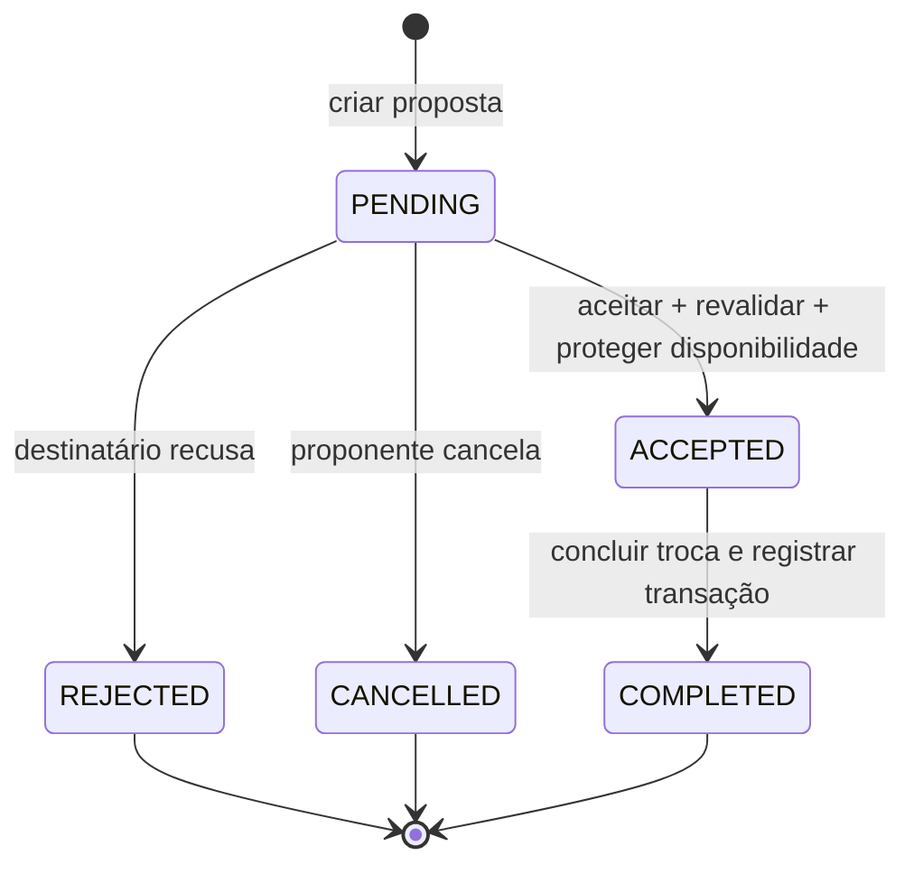
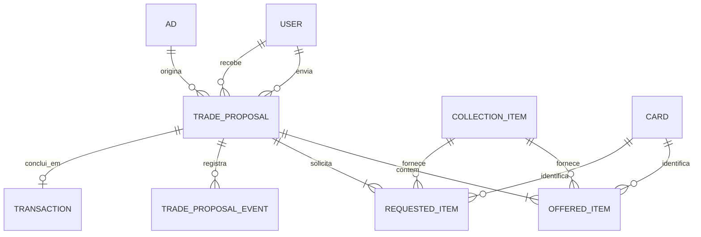

# TCG Market — Modelagem de Propostas de Troca

> **Projeto:** PI3 — TCG Market  
> **Escopo:** modelagem de propostas e negociações de troca com múltiplas cartas.  
> **Status do documento:** proposta de arquitetura, **sem implementação** nesta tarefa.  
> **Tecnologias de referência:** Java, Spring Boot e MongoDB.

## 1. Contexto e decisões arquiteturais

O TCG Market já distingue o catálogo de cartas (`Card`), os exemplares possuídos (`CollectionItem`), os anúncios (`Ad`) e o histórico de negociações concluídas (`Transaction`). O módulo de trocas deve aproveitar essa separação.

**Decisões propostas:**

1. Criar a entidade **`TradeProposal`**, persistida na coleção MongoDB **`trade_proposals`**, para representar uma negociação **ainda não concluída**.
2. Registrar os dois lados em listas de subdocumentos: **`offeredItems`** (cartas do proponente) e **`requestedItems`** (cartas do destinatário). Cada linha possui uma referência à posse específica, quantidade e cópia histórica da carta.
3. Vincular a proposta a **um anúncio de origem (`adId`)**. Ele é o ponto de entrada; uma proposta pode solicitar outras cartas do mesmo destinatário, mesmo que não constem naquele anúncio, desde que pertençam à coleção dele e ele concorde com a proposta.
4. Registrar **eventos de status** no próprio documento, sem substituir a trilha histórica ao atualizar o status atual.
5. Reutilizar **`CardSnapshot`** e, ao concluir uma troca, integrar ao **`Transaction`** existente, em vez de criar um segundo histórico definitivo.
6. Deixar um **complemento financeiro opcional** no domínio. O protótipo aprovado nesta etapa continua sendo **troca de cartas por cartas, sem complemento financeiro na interface**.
7. **Proposta `PENDING` não reserva exemplares.** O aceite exige nova verificação de propriedade e disponibilidade e, na implementação futura, uma estratégia segura de reserva/transferência.

**Compatibilidade com o repositório:** o documento atual de compras já prevê trocas futuras em `Transaction`; `TransactionItem` já tem o sentido da transferência (`fromUserId` e `toUserId`), mas `TransactionType` só contém `SALE` e `Transaction` ainda oferece apenas `fromPaidOrder`. Essas extensões são **pendências de implementação futura**, não mudanças realizadas agora. A classe `Exchange` mencionada no manual descritivo é conceitual/legada e não deve ser criada em paralelo a `TradeProposal`.

## 2. Modelo de domínio

### 2.1 Entidade principal: `TradeProposal`

| Atributo | Tipo de domínio | Persistência MongoDB | Obrigatoriedade e significado |
| --- | --- | --- | --- |
| `id` | `String` | `_id` | Obrigatório. Identificador único da proposta, compatível com as entidades atuais. |
| `proposerId` | `String` | String | Obrigatório. Usuário que enviou a proposta. |
| `recipientId` | `String` | String | Obrigatório. Dono do anúncio que receberá a proposta. Diferente de `proposerId`. |
| `adId` | `String` | String | Obrigatório. Anúncio que originou a negociação. |
| `targetAdSnapshot` | `TargetAdSnapshot` | Subdocumento | Obrigatório. Dados mínimos do anúncio no envio da proposta. |
| `offeredItems` | `List<TradeProposalItem>` | Array de subdocumentos | Obrigatório; pelo menos 1 item. Exemplares oferecidos pelo proponente. |
| `requestedItems` | `List<TradeProposalItem>` | Array de subdocumentos | Obrigatório; pelo menos 1 item. Exemplares solicitados ao destinatário. |
| `financialAdjustment` | `FinancialAdjustment?` | Subdocumento ou `null` | Opcional; `null` para troca sem complemento. |
| `status` | `TradeProposalStatus` | String enum | Obrigatório. Inicia em `PENDING`. |
| `createdAt` | `Instant` | BSON Date | Obrigatório. Criação em UTC. |
| `updatedAt` | `Instant` | BSON Date | Obrigatório. Última alteração de estado. |
| `acceptedAt` | `Instant?` | BSON Date/`null` | Quando o destinatário aceitou. |
| `rejectedAt` | `Instant?` | BSON Date/`null` | Quando o destinatário recusou. |
| `cancelledAt` | `Instant?` | BSON Date/`null` | Quando o proponente cancelou. |
| `completedAt` | `Instant?` | BSON Date/`null` | Quando a troca foi efetivamente concluída. |
| `events` | `List<TradeProposalEvent>` | Array de subdocumentos | Trilha mínima e imutável de criação/transições. |
| `transactionId` | `String?` | String/`null` | Referência à transação gerada após a conclusão, se houver. |
| `version` | `Long` | Number | Versão para controle de concorrência otimista na implementação futura. |
| `requestKey` | `String?` | String/`null` | Chave opcional de idempotência no envio, para evitar duplicação por clique/reenvio. |

**Identificadores:** as referências usam `String` porque é o padrão efetivo das entidades Java existentes; não presumir `ObjectId` nos atributos apenas porque o banco é MongoDB.

### 2.2 Subdocumento: `TradeProposalItem`

Um registro representa **uma posse identificável**, não só um tipo de carta. Assim, duas cópias com condições ou idiomas diferentes podem ser negociadas separadamente.

| Atributo | Tipo | Descrição |
| --- | --- | --- |
| `collectionItemId` | `String` | Referência ao item de coleção do dono daquela linha. |
| `cardId` | `String` | Identificador da carta no catálogo; redundância intencional para rastreabilidade. |
| `sourceAdId` | `String?` | Anúncio que cobre aquela linha, quando aplicável. No item âncora solicitado, deve ser igual a `TradeProposal.adId`. Nas demais linhas pode ser `null`. |
| `quantity` | `Integer` | Número de exemplares negociados; sempre **maior que zero**. |
| `card` | `CardSnapshot` | Cópia dos dados da carta no momento do envio. |

A posição da linha em `offeredItems` ou `requestedItems` determina seu proprietário: **oferecidos = `proposerId`**; **solicitados = `recipientId`**. Não é necessário duplicar `ownerId` dentro de todas as linhas.

**`CardSnapshot` existente:** `cardId`, `name`, `game`, `edition`, `cardNumber`, `imageUrl`, `condition`, `language`. Reutilizar essa estrutura, incluindo condição e idioma do `CollectionItem`, sem depender de consultas futuras para reconstituir a proposta.

### 2.3 Subdocumento: `TargetAdSnapshot`

| Atributo | Tipo | Descrição |
| --- | --- | --- |
| `sellerId` | `String` | Dono do anúncio quando a proposta foi criada. |
| `collectionItemId` | `String` | Posse vinculada ao anúncio no momento da criação. |
| `cardId` | `String` | Carta anunciada no momento da criação. |
| `tradeEnabled` | `Boolean` | Confirma que o anúncio aceitava troca naquele momento. |

Não se trata de uma segunda versão completa do anúncio. A cópia específica da carta/quantidade solicitada fica em `requestedItems`; o snapshot do anúncio preserva o **contexto de origem** mesmo que ele seja editado ou cancelado.

### 2.4 Subdocumento: `FinancialAdjustment` (opcional)

| Atributo | Tipo | Regra |
| --- | --- | --- |
| `amount` | `BigDecimal` | Valor **positivo** de complemento acordado; persistir como Decimal128, nunca `double`. |
| `currency` | `String`/enum | Inicialmente `BRL`. |
| `payerId` | `String` | Qual dos dois participantes paga o complemento. |
| `payeeId` | `String` | Qual dos dois participantes recebe. Deve ser o outro participante. |

- **Sem complemento:** `financialAdjustment = null`.
- **Com complemento:** os quatro campos são obrigatórios. O valor representa o **acordo entre os usuários**, não uma avaliação automática da diferença de preço das cartas.
- A existência desse subdocumento **não significa pagamento autorizado ou concluído**. A futura integração de pagamento deverá validar sua liquidação antes de finalizar a negociação.
- O fluxo inicial aprovado de UX não expõe nem processa esse recurso; a modelagem apenas comporta sua evolução.

### 2.5 Subdocumento: `TradeProposalEvent`

| Atributo | Tipo | Descrição |
| --- | --- | --- |
| `eventType` | Enum | `CREATED`, `ACCEPTED`, `REJECTED`, `CANCELLED`, `COMPLETED`. |
| `fromStatus` | `TradeProposalStatus?` | Status anterior; `null` no evento de criação. |
| `toStatus` | `TradeProposalStatus` | Status resultante. |
| `actorId` | `String` | Usuário que iniciou a ação ou identificador técnico do processo de conclusão. |
| `occurredAt` | `Instant` | Instante UTC da ação. |
| `reasonCode` | `String?` | Motivo padronizado opcional para auditoria/diagnóstico. |

Os eventos são acrescentados **sem apagar ou alterar os anteriores**. Para a versão inicial, com termos imutáveis e poucas transições, o array permanece pequeno. Se futuramente houver contrapropostas, chat, revisões sucessivas ou auditoria extensa, o histórico detalhado deve ser separado em coleção própria ou organizado por versões negociadas.

## 3. Status e ciclo de vida

| Status | Significado | Quem pode provocar a transição |
| --- | --- | --- |
| `PENDING` | Proposta enviada, aguardando resposta. É o status inicial. | Criação pelo proponente autenticado. |
| `ACCEPTED` | O destinatário aceitou os termos **e a disponibilidade foi validada/protegida**. Ainda não equivale a troca concluída. | Destinatário da proposta. |
| `REJECTED` | Destinatário recusou a proposta. Estado terminal. | Destinatário da proposta. |
| `CANCELLED` | Proponente retirou a proposta antes do aceite. Estado terminal. | Proponente da proposta. |
| `COMPLETED` | Troca executada e registrada no histórico de transações. Estado terminal **recomendado** além dos quatro obrigatórios. | Fluxo de conclusão, após confirmações e transferência. |

### Transições válidas



- Não é permitido aceitar, recusar ou cancelar duas vezes uma proposta que já saiu de `PENDING`.
- Para simplificar o escopo atual, os **termos da proposta são imutáveis após o envio**. Uma alteração negociada exige nova proposta; revisões/contrapropostas podem ser tratadas em tarefa futura.
- Após `ACCEPTED`, eventual desistência, disputa, falha de entrega ou expiração de reserva **não estão especificadas nesta tarefa** e exigirão regras próprias. Não voltar silenciosamente o status para `PENDING`.
- **`ACCEPTED` ≠ `COMPLETED`:** o diagrama de troca atual prevê acordo, combinação de entrega e confirmação de recebimento antes de concluir o histórico. O status extra evita tratar aceitação como entrega efetuada.

## 4. Relacionamentos e cardinalidades

| Relação | Cardinalidade | Interpretação |
| --- | --- | --- |
| `User` → `TradeProposal` (proponente) | 1:N | Um usuário pode enviar muitas propostas. |
| `User` → `TradeProposal` (destinatário) | 1:N | Um usuário pode receber muitas propostas. |
| `Ad` → `TradeProposal` | 1:N | Um anúncio de troca pode originar diversas propostas, sujeitas à disponibilidade no aceite. |
| `TradeProposal` → `TradeProposalItem` | 1:N em cada lado | Uma proposta contém **1..N** itens oferecidos e **1..N** solicitados. |
| `CollectionItem` → `TradeProposalItem` | 1:N histórico | Uma posse pode aparecer em várias propostas, mas a disponibilidade precisa ser validada no aceite. |
| `Card` → `TradeProposalItem` | 1:N histórico | O catálogo identifica a carta; o `CardSnapshot` conserva seus dados históricos. |
| `TradeProposal` → `Transaction` | 1:0..1 | A troca concluída gera no máximo uma transação definitiva. |



> No diagrama ER, `OFFERED_ITEM` e `REQUESTED_ITEM` são **duas funções do mesmo tipo embutido `TradeProposalItem`**, não duas coleções MongoDB independentes.

## 5. Regras de negócio e validações

### 5.1 Ao criar a proposta

1. `proposerId` deve identificar o usuário autenticado; `recipientId` deve ser diferente dele.
2. `adId` deve existir, estar `ACTIVE`, ter `tradeEnabled = true`, possuir `remainingQuantity > 0`, e seu `sellerId` deve corresponder a `recipientId`.
3. `offeredItems` e `requestedItems` devem conter ao menos uma linha cada. Toda `quantity` deve ser inteira e positiva.
4. Para cada item ofertado: `CollectionItem.userId == proposerId`. Para cada item solicitado: `CollectionItem.userId == recipientId`.
5. Toda linha deve referenciar um `Card` compatível com `CollectionItem.cardId`. O snapshot deve conter os dados da posse e do catálogo naquele momento.
6. **Pelo menos uma** linha solicitada deve representar a posse do anúncio de origem: `sourceAdId == adId`, `collectionItemId == Ad.collectionItemId` e `cardId == Ad.cardId`.
7. Outras linhas solicitadas podem ser da coleção do destinatário, ainda que não estejam anunciadas; isso é **proposta de domínio**, não autorização automática para transferi-las. O dono decide ao aceitar.
8. Evitar linhas duplicadas para o mesmo `collectionItemId` dentro do mesmo lado; se presentes, devem ser consolidadas e ter a quantidade somada antes das verificações.
9. Se houver `financialAdjustment`, conferir participantes, sentido, moeda e valor. Na primeira interface, enviar `null`.
10. Salvar `PENDING`, as cópias históricas e um evento `CREATED`. Nenhuma transferência ou reserva permanente deve ocorrer apenas pelo envio.

### 5.2 Imediatamente antes do aceite

1. A proposta ainda deve estar `PENDING`, e a ação deve ser do `recipientId` autenticado.
2. Reconsultar **todos** os `CollectionItem` referenciados; verificar se ainda existem, se cada proprietário continua correto e se a quantidade disponível cobre o solicitado.
3. Reconsultar o anúncio âncora; exigir `ACTIVE`, `tradeEnabled = true`, proprietário correspondente e quantidade **não ocupada por outras operações**.
4. **Não usar apenas `CollectionItem.quantity`.** O modelo atual já controla `committedQuantity` e `adReservations` na coleção e `purchaseHolds` no anúncio. A disponibilidade precisa descontar os compromissos aplicáveis, evitando contagem dupla da mesma reserva.
5. Para a linha de origem do anúncio, validar disponibilidade **dentro do anúncio**, levando em conta reservas de compra e futuras reservas de troca. Para itens sem anúncio, usar a disponibilidade **livre na coleção**, excluindo quantidades comprometidas com anúncios e outras operações.
6. Tratar todas as linhas da proposta como **uma única decisão lógica**: se qualquer item estiver indisponível, o aceite deve falhar **sem concluir aceite parcial** e sem alterar as quantidades negociadas.
7. Quando o aceite for permitido, proteger/comprometer os exemplares de ambos os lados de modo seguro contra concorrência. A estratégia exata (operações condicionais, controle de versão, transações MongoDB e/ou compensação) será decidida na implementação.
8. Registrar `ACCEPTED`, `acceptedAt`, `updatedAt` e evento `ACCEPTED` **somente após** obter as garantias necessárias sobre a disponibilidade. Reenvios da mesma operação não podem duplicar reservas ou baixas.

**Regra de disponibilidade conceitual:**

```text
Item sem anúncio: disponibilidade = quantidade da coleção − quantidade já comprometida
Item do anúncio:  disponibilidade = quantidade restante do anúncio
                                   − reservas de compra
                                   − reservas de troca futuras
```

A reserva que já integra `committedQuantity` por ter sido originada por um anúncio **não pode ser subtraída novamente** na verificação de exemplares do próprio anúncio. Também não é válido presumir que `remainingQuantity` já desconta `purchaseHolds`: no modelo atual, isso é calculado separadamente.

**Concorrência relevante:** duas propostas podem citar o mesmo exemplar; uma compra pode pagar pelo exemplar enquanto uma proposta está pendente. O sucesso da validação feita na criação **não garante** disponibilidade no momento do aceite.

### 5.3 Após o aceite / conclusão

- Aceitar significa concordar e proteger a disponibilidade, **não** transferir automaticamente os exemplares nem afirmar que as partes receberam suas cartas.
- A conclusão só ocorrerá após as condições operacionais definidas para a entrega/confirmação; o fluxo atual de troca prevê confirmação de ambos os usuários.
- Na conclusão, transferir/atualizar os estoques conforme o fluxo de domínio, liberar ou consumir reservas pertinentes e criar **uma única `Transaction` de tipo `TRADE`**.
- A `Transaction` usará `sourceId = TradeProposal.id` e `TransactionItem` com sentidos explícitos: `proposerId → recipientId` para itens oferecidos; `recipientId → proposerId` para itens solicitados.
- O índice único já previsto em `transactions (type, sourceId)` permite impedir histórico duplicado. A implementação precisa estender `TransactionType` com `TRADE` e providenciar a criação da transação de troca.
- Os campos `sellerId`/`buyerId` de `Transaction` são orientados a vendas; **não assumir** que os participantes de uma troca sejam literalmente comprador e vendedor. A adaptação dos campos/consultas para histórico bilateral é tema da futura implementação.
- Se houver complemento financeiro, sua liquidação deverá ser verificada antes de declarar a troca `COMPLETED`; a forma de pagamento está fora do escopo atual.

## 6. Integridade histórica

A negociação deve continuar interpretável mesmo que anúncio, catálogo ou itens da coleção sejam editados ou removidos:

| Informação preservada | Estratégia |
| --- | --- |
| Participantes | `proposerId` e `recipientId` gravados na proposta. |
| Anúncio de origem | `adId` mais `targetAdSnapshot`. |
| Identidade de cada posse | `collectionItemId` e `cardId` em cada linha. |
| Nome, jogo, edição, número, imagem, condição, idioma | `CardSnapshot` copiado em cada linha. |
| Quantidades acordadas | `quantity` imutável em cada linha. |
| Complemento negociado | `financialAdjustment` imutável, quando existente. |
| Evolução da negociação | `status`, datas e `events` append-only. |
| Resultado final | `transactionId` e `Transaction` imutável, após conclusão. |

**Referências são para validação atual; snapshots são para histórico.** Ao exibir uma proposta antiga, não sobrescrever os dados históricos com o estado mais recente do catálogo ou coleção. A política de retenção e anonimização de dados pessoais deve ser tratada separadamente.

## 7. Exemplo de documento MongoDB

Exemplo **ilustrativo** de proposta `PENDING` de múltiplas cartas por ambos os lados. Os identificadores são fictícios e os valores de `game`, `condition` e `language` seguem os enums Java atualmente encontrados no repositório.

```json
{
  "_id": "proposal-demo-001",
  "proposerId": "user-ana",
  "recipientId": "user-bruno",
  "adId": "ad-900",
  "targetAdSnapshot": {
    "sellerId": "user-bruno",
    "collectionItemId": "item-b1",
    "cardId": "card-001",
    "tradeEnabled": true
  },
  "offeredItems": [
    {
      "collectionItemId": "item-a1",
      "cardId": "card-101",
      "sourceAdId": null,
      "quantity": 2,
      "card": {
        "cardId": "card-101",
        "name": "Carta Exemplo A",
        "game": "POKEMON",
        "edition": "Edição Exemplo A",
        "cardNumber": "010",
        "imageUrl": "https://example.org/cards/101.png",
        "condition": "NEAR_MINT",
        "language": "PORTUGUESE"
      }
    },
    {
      "collectionItemId": "item-a2",
      "cardId": "card-102",
      "sourceAdId": null,
      "quantity": 1,
      "card": {
        "cardId": "card-102",
        "name": "Carta Exemplo B",
        "game": "YUGIOH",
        "edition": "Edição Exemplo B",
        "cardNumber": "027",
        "imageUrl": "https://example.org/cards/102.png",
        "condition": "LIGHTLY_PLAYED",
        "language": "ENGLISH"
      }
    }
  ],
  "requestedItems": [
    {
      "collectionItemId": "item-b1",
      "cardId": "card-001",
      "sourceAdId": "ad-900",
      "quantity": 1,
      "card": {
        "cardId": "card-001",
        "name": "Carta Exemplo C",
        "game": "POKEMON",
        "edition": "Edição Exemplo C",
        "cardNumber": "003",
        "imageUrl": "https://example.org/cards/001.png",
        "condition": "NEAR_MINT",
        "language": "PORTUGUESE"
      }
    },
    {
      "collectionItemId": "item-b2",
      "cardId": "card-002",
      "sourceAdId": null,
      "quantity": 2,
      "card": {
        "cardId": "card-002",
        "name": "Carta Exemplo D",
        "game": "MAGIC_THE_GATHERING",
        "edition": "Edição Exemplo D",
        "cardNumber": "004",
        "imageUrl": "https://example.org/cards/002.png",
        "condition": "MODERATELY_PLAYED",
        "language": "ENGLISH"
      }
    }
  ],
  "financialAdjustment": null,
  "status": "PENDING",
  "createdAt": "2026-11-01T19:00:00Z",
  "updatedAt": "2026-11-01T19:00:00Z",
  "acceptedAt": null,
  "rejectedAt": null,
  "cancelledAt": null,
  "completedAt": null,
  "events": [
    {
      "eventType": "CREATED",
      "fromStatus": null,
      "toStatus": "PENDING",
      "actorId": "user-ana",
      "occurredAt": "2026-11-01T19:00:00Z",
      "reasonCode": null
    }
  ],
  "transactionId": null,
  "version": 0,
  "requestKey": "demo-request-001"
}
```

Para habilitar complemento financeiro em evolução futura, substituir `null` por um subdocumento como este (valor em **Extended JSON** para Decimal128):

```json
{
  "amount": { "$numberDecimal": "15.00" },
  "currency": "BRL",
  "payerId": "user-ana",
  "payeeId": "user-bruno"
}
```

## 8. Índices e consultas previstas (proposta, não implementados)

| Índice | Finalidade |
| --- | --- |
| `{ proposerId: 1, createdAt: -1 }` | Listar propostas enviadas por um usuário. |
| `{ recipientId: 1, status: 1, createdAt: -1 }` | Listar propostas recebidas e pendentes. |
| `{ adId: 1, status: 1 }` | Consultar propostas vinculadas a um anúncio. |
| `{ proposerId: 1, requestKey: 1 }` **único parcial**, se adotado | Evitar duplicações por reenvio com chave informada. |

Não indexar todos os campos internos dos snapshots: eles existem para **histórico**, não como catálogo secundário. O `version` deve servir para controle de concorrência, não necessariamente como índice de busca.

## 9. Repercussão nas entidades existentes (somente para tarefas futuras)

| Elemento atual | Situação e orientação futura |
| --- | --- |
| `User` | Referenciado duas vezes: proponente e destinatário. Nenhuma alteração de esquema é necessária agora. |
| `Ad` | Continua como anúncio por posse, venda/troca ou ambos. Aceite deve considerar disponibilidade, `purchaseHolds` e futuras reservas de troca. |
| `CollectionItem` | Continua como fonte de posse e quantidade. Considerar `committedQuantity`/`adReservations`; preparar proteção de itens não anunciados durante o aceite. |
| `CardSnapshot` | **Reutilizar sem duplicar estrutura** para ambas as listas. |
| `TransactionType` | Acrescentar `TRADE` na implementação da conclusão. Atualmente só existe `SALE`. |
| `Transaction` | Criar mecanismo de conversão de proposta concluída para histórico de troca, com `sourceId = proposal.id` e participantes tratados de forma bilateral. |
| `TransactionItem` | Já suporta `fromUserId`, `toUserId`, `card`, `quantity` e preço nulo. Deve ser usado em ambos os sentidos da troca. |
| `Exchange` do manual descritivo | Revisar conceito legado, substituindo-o pela separação **`TradeProposal` (negociação)** + **`Transaction` (conclusão)**. |
| Diagrama de classes / fluxo de troca | Incluir `TradeProposal` e subdocumentos; acrescentar validação no aceite; distinguir `ACCEPTED` de `COMPLETED`. |

## 10. Pontos de atenção para o refinamento

1. **Entrega/controvérsias:** o desenho de atividades prevê confirmação de recebimento por ambas as partes, mas as regras de cancelamento/disputa após o aceite ainda precisam de definição específica.
2. **Reserva e concorrência:** documentada como invariante de domínio; decidir em tarefa técnica futura como tornar proteção e consumo dos dois lados idempotentes e seguros.
3. **Troca com outras cartas não anunciadas:** a modelagem permite, mas a interface poderá inicialmente limitar `requestedItems` à carta do anúncio; isso não invalida o esquema.
4. **Complemento financeiro:** permitido apenas como estrutura opcional; habilitação da UI e pagamentos dependerão de decisões do produto e nova implementação.
5. **Contrapropostas:** não contempladas agora. Para preservar histórico, não editar silenciosamente listas aceitas ou rejeitadas.
6. **`COMPLETED` adicional:** recomendado para não confundir aceite de termos com transferência efetiva; se o grupo optar por manter estritamente quatro status, será necessário outro mecanismo explícito para indicar conclusão operacional.

## 11. Critérios de aceite — rastreabilidade

- [x] Proponente representado: `proposerId`.
- [x] Destinatário representado: `recipientId`.
- [x] Múltiplas cartas suportadas: `offeredItems[]` e `requestedItems[]`.
- [x] Quantidades: `TradeProposalItem.quantity > 0`.
- [x] Complemento financeiro opcional: `FinancialAdjustment`.
- [x] Status e transições definidos, com `PENDING` inicial.
- [x] Anúncio relacionado: `adId` e `targetAdSnapshot`, mais `sourceAdId` na linha âncora.
- [x] Suporte à validação no aceite: propriedade, anúncio ativo, disponibilidade e concorrência.
- [x] Histórico mínimo preservado: `CardSnapshot`, termos imutáveis, datas, eventos e vínculo com `Transaction`.

> **Conclusão:** a modelagem conceitual cobre os critérios solicitados. **Não houve mudança no backend, banco de dados, frontend ou arquivos do repositório nesta tarefa.** A implementação e a atualização dos diagramas `.drawio` permanecem etapas posteriores.

## 12. Documentações de referência do repositório

- `docs/diagrams/Modelagem da Classe Ad.md`
- `docs/diagrams/Modelagem de Carrinho, Pedido, Pagamento e Transação.md`
- `docs/diagrams/Manual Descritivo das Classes - V2.md`
- `docs/diagrams/Diagrama de Atividade - Fluxo de troca.drawio`
- `backend/src/main/java/com/pitcc/model/Ad.java`
- `backend/src/main/java/com/pitcc/model/CollectionItem.java`
- `backend/src/main/java/com/pitcc/model/CardSnapshot.java`
- `backend/src/main/java/com/pitcc/model/Transaction.java`
- `backend/src/main/java/com/pitcc/model/TransactionItem.java`
- `backend/src/main/java/com/pitcc/model/TransactionType.java`
